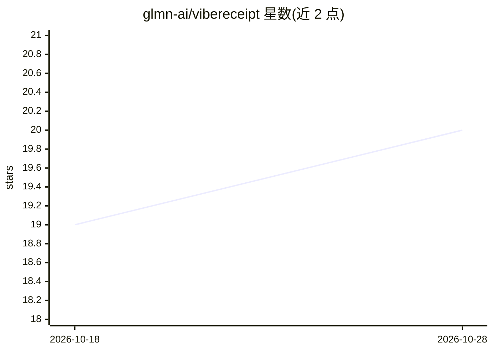

# glmn-ai/vibereceipt

⭐ 20 · TypeScript · MIT · 推送 2026-10-13 · [GitHub](https://github.com/glmn-ai/vibereceipt) · [官网](https://neurosquad.ai/en/vibe-receipt/) · 组织维护

**把 AI 编程工具的本地日志打印成消费小票：token 与 API 价成本**

读取 Claude Code、Codex CLI 与 OpenCode 已存在本机的会话日志，以热敏小票形式在终端打印会话数、提示词、工具调用、各类 token 与按 API 牖价折算的成本，并保存 4:5 PNG 供分享；`--plan` 可与订阅价对比。解析与定价 vendored 自 @neurosquad/core，成本用整数皮美元精确计算。零运行时依赖、无网络请求、只读日志，提示词内容在读取时即被约减为时间戳与计数。需 Node 18.17+（读 OpenCode SQLite 需 22.13+）。

## 筛选速览

| 维度 | 判定 | 备注 |
|---|---|---|
| AI 角色 | `ai-enhanced` | 去掉 AI 部分产品仍成立 |
| 许可风险 | `permissive` | MIT |
| 部署形态 | `library` | 以包/库形式分发 |
| 模型依赖 | — | README 未给出锁定关系 |
| 硬件要求 | — | 无带数字的原话,不猜 |
| 安装摩擦 | `low` | 无编译、无系统依赖或容器化 |
| 成熟度 | — | 结构信号不足 |

## 能力要点

- 支持 Claude Code / Codex CLI / OpenCode 三种 harness 的本地日志读取
- 按 API 牖价精确计算成本（整数皮美元、分 token 类型计价、版本化价格表）
- 零运行时依赖、无网络调用、日志只读，提示文本即时约减保护隐私
- `--plan` 订阅对比与趣味计数器（rage tax、夜猫提示、最长连续天数等）

## 适用场景

- 看看我的 AI 编程用量按 API 价格折算值多少钱
- 订阅计划与按量付费哪种更划算
- 生成一张适合发到社交平台的使用小票图

## 场景标签

 · 领域:开发者工具/LLM 用量统计

## 证据(README 行号)

> L20: vibereceipt reads the session logs that Claude Code, Codex CLI and OpenCode
> L118: The parsers and the pricing are vendored from

## 星数曲线

2026-10-18 19 → 2026-10-28 20（+1）

---
*卡片 v1 · prompt 1.4 · 生成 2026-10-28 · 置信度 high · 依据 README sha `f875917162d1` · [字段定义](../../DATASET.md)*
