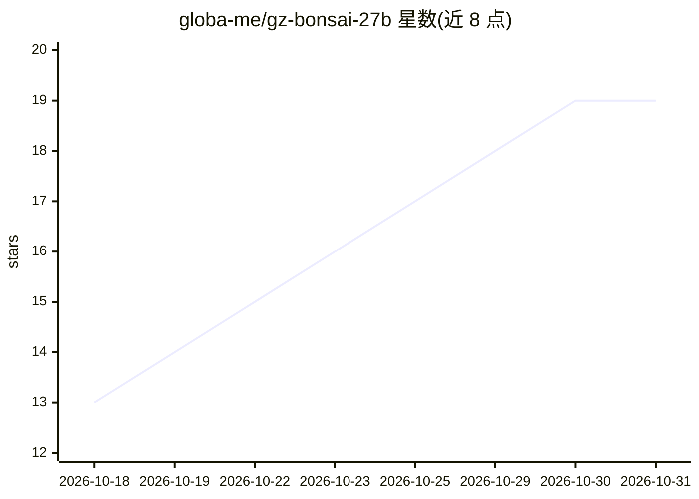

# globa-me/gz-bonsai-27b

⭐ 19 · TypeScript · MIT · 推送 2026-10-02 · [GitHub](https://github.com/globa-me/gz-bonsai-27b) · [官网](https://zakharov.asia/) · 个人维护

**macOS 本地聊天应用：一键下载运行 PrismML Bonsai 系列模型**

面向 Apple Silicon Mac 用户的 Tauri 2 本地 LLM 聊天应用：内置签名版 PrismML llama.cpp fork 的 llama-server，提供 Bonsai 1.7B/4B/8B/27B（1-bit 与 ternary）模型目录，下载带 SHA-256 校验与断点续传，聊天走 /v1/chat/completions 流式接口并暴露 OpenAI 兼容端点 127.0.0.1:8080/v1。含本地 RAG（PDF/DOCX/TXT/MD/CSV/JSON 带引用）、可选 Tavily Keyless/Brave 网页搜索、vision projector 支持、RU/EN 界面。服务器仅绑定 127.0.0.1，更新需手动从 GitHub Releases 下载，无 MCP 工具与自动更新。

## 筛选速览

| 维度 | 判定 | 备注 |
|---|---|---|
| AI 角色 | `ai-native` | 本体是模型或模型工具 |
| 许可风险 | `permissive` | MIT |
| 部署形态 | `library` | 以包/库形式分发 |
| 模型依赖 | local-ok | 支持本地模型 |
| 硬件要求 | — | 无带数字的原话,不猜 |
| 安装摩擦 | `low` | 无编译、无系统依赖或容器化 |
| 成熟度 | — | 结构信号不足 |

## 能力要点

- 内置 PrismML llama.cpp fork 的 llama-server，OpenAI 兼容端点 http://127.0.0.1:8080/v1
- 模型目录覆盖 Bonsai 1.7B–27B（1-bit 与 ternary），下载带 SHA-256 校验与断点续传
- 本地 RAG 支持 PDF/DOCX/TXT/Markdown/CSV/JSON 并给出片段引用
- 网络绑定限 127.0.0.1，外部搜索默认关闭，Brave key 仅存 macOS Keychain

## 适用场景

- 在 Mac 上不接触终端命令即可本地运行 Bonsai 模型聊天
- 对本地文档做带引用的问答（RAG）
- 为其他工具提供本机 OpenAI 兼容 API 端点
- 需要数据留在本机的私有 LLM 使用场景

## 场景标签

`聊天机器人` `文档问答` · 领域:对话与助手

## 证据(README 行号)

> L49: Официальные модели PrismML можно запускать локально, но новичку приходится разбираться в GGUF, совместимых сборках 
> L74: - потоковый ответ через `/v1/chat/completions`;
> L81: - локальный RAG по PDF, DOCX, TXT, Markdown, CSV и JSON с цитатами использованных фрагментов;

## 星数曲线

2026-10-18 13 → 2026-10-31 19（+6）

---
*卡片 v1 · prompt 1.4 · 生成 2026-10-29 · 置信度 high · 依据 README sha `391eedb195fa` · [字段定义](../../DATASET.md)*
