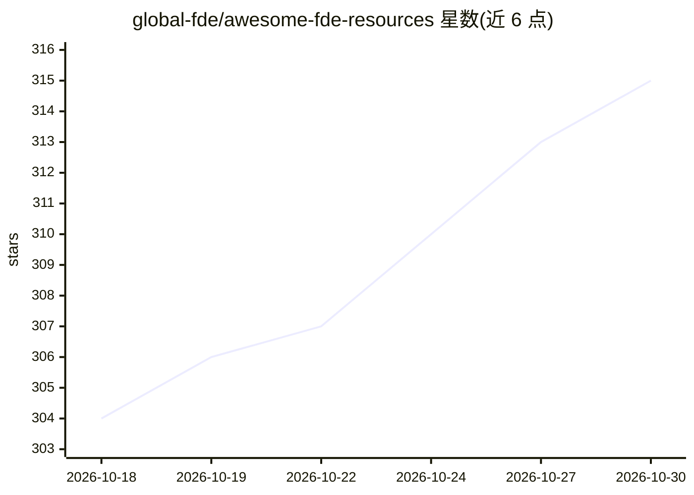

# global-fde/awesome-fde-resources

⭐ 315 · Python · CC-BY-4.0 · 推送 2026-08-04 · [GitHub](https://github.com/global-fde/awesome-fde-resources) · 组织维护 · 中文 README

**面向前置部署工程师（FDE）的资源清单：课程、实践、案例与工具**

策展型 awesome 清单，收录与生产环境 AI 交付相关的资源：入门课程与指南、生产最佳实践、案例与参考实现、评测/可观测性/Agent 工具等，另设 FDE 成员网络目录（要求公开证据与利益披露）及中文托管资源区（白皮书、访谈、指南等，版权归原作者并附来源记录）。条目按目录组织并附一句话说明，无代码安装运行形态。

## 筛选速览

| 维度 | 判定 | 备注 |
|---|---|---|
| AI 角色 | `ai-knowledge` | 知识聚合/清单类 |
| 许可风险 | `viral` | CC-BY-4.0 |
| 部署形态 | `None` |  |
| 模型依赖 | — | README 未给出锁定关系 |
| 硬件要求 | — | 无带数字的原话,不猜 |
| 安装摩擦 | `low` | 无编译、无系统依赖或容器化 |
| 成熟度 | — | 结构信号不足 |

## 能力要点

- 按入门/最佳实践/案例/工具/成员网络/中文资源组织的策展条目
- 覆盖 LLM 课程、MLOps、Agent 评测、MCP 安全等主题
- 中文托管资源附 .source.yml 来源与许可记录

## 适用场景

- FDE 或 AI 工程师查找学习路径与生产实践参考
- 选型时检索评测、可观测性与 Agent 工具清单
- 了解 FDE 角色的中文资料与行业访谈

## 场景标签

`精选清单` · 领域:学习与行业

## 证据(README 行号)

> L5: A focused list of high-quality resources for Forward Deployed Engineers and production AI delivery.
> L9: ## Contents

## 星数曲线

2026-10-18 304 → 2026-10-30 315（+11）

---
*卡片 v1 · prompt 1.4 · 生成 2026-10-21 · 置信度 high · 依据 README sha `4b69ecfd666e` · [字段定义](../../DATASET.md)*
