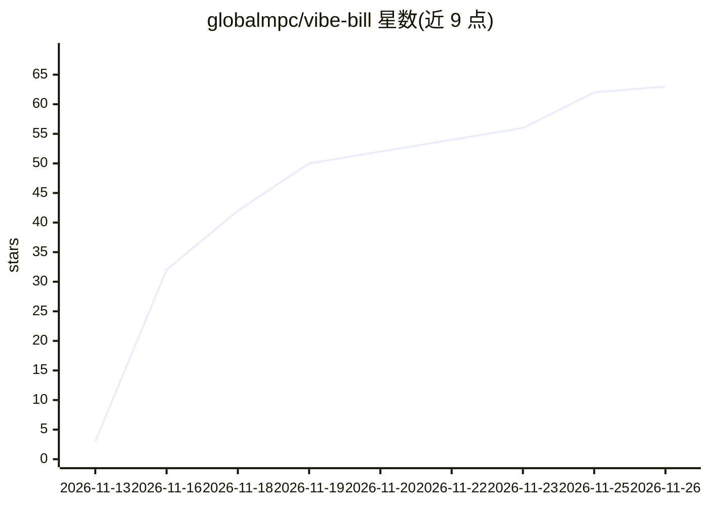

# globalmpc/vibe-bill

⭐ 63 · TypeScript · MIT · 推送 2026-11-20 · [GitHub](https://github.com/globalmpc/vibe-bill) · 个人维护

**给 vibe-coded 应用估算多规模用户量运行成本的 Claude Code 技能**

一个 Claude Code skill：在项目里输入 /vibe-bill 后，读取代码中的 AI 调用（OpenAI/Anthropic/Google/OpenRouter）与第三方服务（Supabase/Vercel/Clerk/Resend/Stripe 等）使用情况，估算 100/1k/10k/100k 用户的月度账单，标记推高账单的代码模式（如每次按键调用 AI、无缓存重复请求），并生成可分享的收据图与报告。价格来自 OpenRouter 公开列表与网络查询；Claude 只描述用法，金额计算由代码完成。结果为估算而非发票，折扣与免费额度不计入；服务识别依赖已知包名与代码模式，可能遗漏。

## 筛选速览

| 维度 | 判定 | 备注 |
|---|---|---|
| AI 角色 | `ai-ecosystem` | LLM/agent 周边工具 |
| 许可风险 | `permissive` | MIT |
| 部署形态 | `library` | 以包/库形式分发 |
| 模型依赖 | — | README 未给出锁定关系 |
| 硬件要求 | — | 无带数字的原话,不猜 |
| 安装摩擦 | `low` | 无编译、无系统依赖或容器化 |
| 成熟度 | — | 结构信号不足 |

## 能力要点

- 估算 100/1k/10k/100k（可自定义 1-6 档）用户的月度运行账单
- 标记 8 类推高账单的代码模式（每次按键 AI 调用、无缓存重复请求、无限流公开端点等）
- 生成收据图（receipt.png）与逐档报告（report.md）
- AI 价格取自 OpenRouter 列表，收据标注价格来源与检查日期，超 30 天标记可能过期

## 适用场景

- 上线前估算 AI 应用的 API 与服务月度成本
- 检查代码里悄悄烧钱的模式并拿到修改线索
- 生成可分享的成本收据图用于展示或讨论

## 场景标签

 · 领域:开发者工具/云成本估算

## 证据(README 行号)

> L9: vibe-bill is a Claude Code skill. Type `/vibe-bill` in your project and it:
> L11: - estimates your monthly bill at 100, 1,000, 10,000 and 100,000 users (or any user counts you choose, see below),
> L76: - **The AI never makes up a dollar amount.** Claude only describes how your app uses things; the code does all the 

## 星数曲线

2026-11-13 3 → 2026-11-26 63（+60）

---
*卡片 v1 · prompt 1.4 · 生成 2026-11-18 · 置信度 high · 依据 README sha `8aee1176d09e` · [字段定义](../../DATASET.md)*
