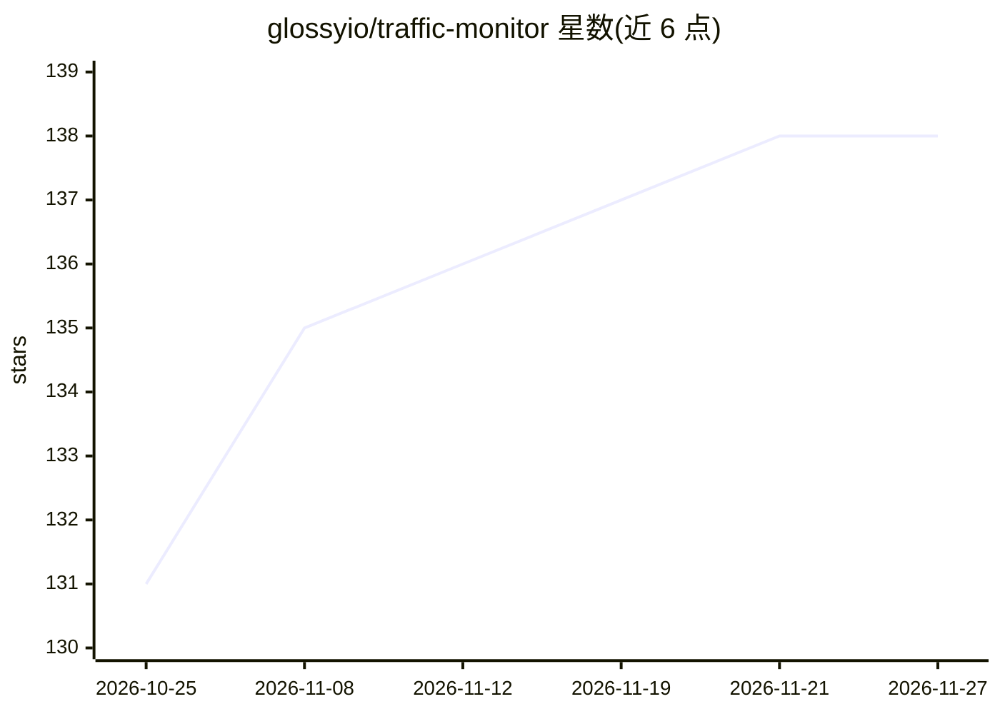

# glossyio/traffic-monitor

⭐ 138 · Python · GPL-3.0 · 推送 2026-11-26 · [GitHub](https://github.com/glossyio/traffic-monitor) · [官网](https://www.trafficmonitor.ai) · 组织维护

**开源智慧交通监测设备软件：边缘检测计数与雷达测速**

基于 Raspberry Pi 5 与普通硬件构建的交通监测软件，利用边缘机器学习目标检测与多普勒雷达，统计行人、自行车、汽车等道路使用者数量并测量车速；检测在本地推理，无需云端，仅上传用户指定的数据。提供 Node-RED 仪表盘、Frigate 配置界面与 go2rtc 摄像头管理界面，可通过 SSH 脚本安装，支持长期道路部署与低功耗临时部署，并可扩展 Raspberry Pi 兼容传感器（空气质量、噪声、温湿度等）。

## 筛选速览

| 维度 | 判定 | 备注 |
|---|---|---|
| AI 角色 | `ai-native` | 本体是模型或模型工具 |
| 许可风险 | `viral` | GPL-3.0 |
| 部署形态 | `None` |  |
| 模型依赖 | — | README 未给出锁定关系 |
| 硬件要求 | — | 无带数字的原话,不猜 |
| 安装摩擦 | `low` | 无编译、无系统依赖或容器化 |
| 成熟度 | — | 结构信号不足 |

## 能力要点

- 边缘机器学习目标检测：本地推理，无需云端
- 多普勒雷达测速，捕获事件图像与视频
- 支持 Raspberry Pi 兼容传感器扩展（空气质量、噪声、光照、温湿度、PM 颗粒物）
- Node-RED 仪表盘展示事件计数与速度统计

## 适用场景

- 长期部署在道路旁统计车流、人流利用率
- 监测并记录车辆超速事件
- 低功耗电池供电的临时 remote 路况采集
- 加装空气质量等传感器做环境监测

## 场景标签

`目标检测` · 领域:感知与多模态

## 证据(README 行号)

> L7: TrafficMonitor.ai, the Traffic Monitor, is an open source smart city traffic monitoring software built with commodit
> L29: The Traffic Monitor is designed on the Raspberry Pi 5 and a variety of commodity hardware to keep it accessible, lo

## 星数曲线

2026-10-25 131 → 2026-11-27 138（+7）

---
*卡片 v1 · prompt 1.4 · 生成 2026-11-27 · 置信度 high · 依据 README sha `8d1457176334` · [字段定义](../../DATASET.md)*
