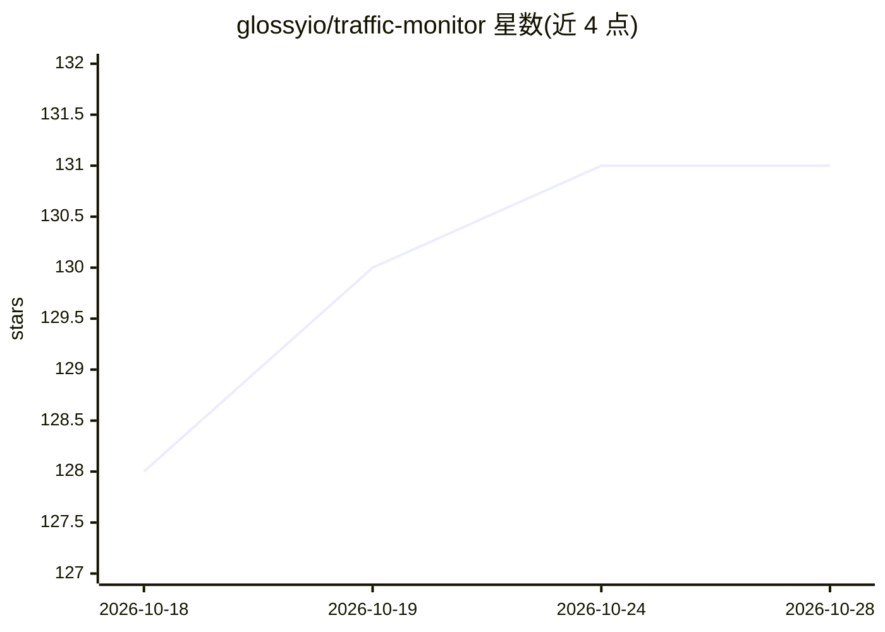

# glossyio/traffic-monitor

⭐ 131 · Python · GPL-3.0 · 推送 2026-10-28 · [GitHub](https://github.com/glossyio/traffic-monitor) · [官网](https://www.trafficmonitor.ai) · 组织维护

**边缘 ML+多普勒雷达的道路交通监测软硬件方案**

开源智慧城市交通监测软件：在 Raspberry Pi 5 等廉价硬件上运行边缘机器学习目标检测，结合多普勒雷达，统计行人、自行车、汽车的通过数量并测量车速，可抓拍事件图像与视频。推理在本地进行，不依赖云端，仅上传用户指定的数据。通过 Raspberry Pi OS Lite + git clone 源码脚本安装，UI 基于 Node-RED 仪表盘与 Frigate 配置界面，支持长期路面部署与电池供电的临时远程部署，可扩展空气质量等传感器。

## 筛选速览

| 维度 | 判定 | 备注 |
|---|---|---|
| AI 角色 | `ai-native` | 本体是模型或模型工具 |
| 许可风险 | `viral` | GPL-3.0 |
| 部署形态 | `None` |  |
| 模型依赖 | — | README 未给出锁定关系 |
| 硬件要求 | — | 无带数字的原话,不猜 |
| 安装摩擦 | `low` | 无编译、无系统依赖或容器化 |
| 成熟度 | — | 结构信号不足 |

## 能力要点

- 边缘 ML 目标检测统计汽车/自行车/行人数量
- 多普勒雷达测速并抓拍事件图像与视频
- 本地推理、无云端依赖的隐私设计
- 可扩展树莓派兼容传感器（空气质量、噪声、PM 等）

## 适用场景

- 长期部署监测道路使用情况与流量统计
- 临时远程部署采集车速与交通事件数据
- 智慧城市项目搭建低成本本地交通监测节点

## 场景标签

`目标检测` · 领域:感知与多模态

## 证据(README 行号)

> L7: TrafficMonitor.ai, the Traffic Monitor, is an open source smart city traffic monitoring software built with commodit
> L14: - 📷 Privacy-focused, local inferencing (no cloud required) only collects and sends data you specify.

## 星数曲线

2026-10-18 128 → 2026-10-28 131（+3）

---
*卡片 v1 · prompt 1.4 · 生成 2026-10-22 · 置信度 high · 依据 README sha `bd9833a87e33` · [字段定义](../../DATASET.md)*
