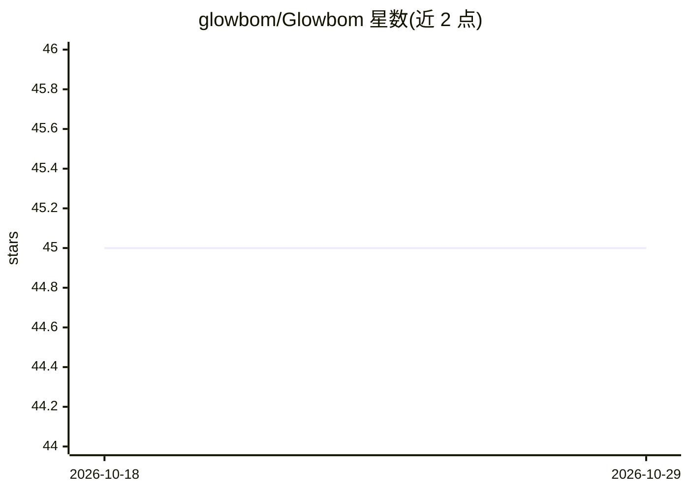

# glowbom/Glowbom

⭐ 45 · HTML · MIT · 推送 2026-10-28 · [GitHub](https://github.com/glowbom/Glowbom) · [官网](https://glowbom.com/) · 组织维护

**把想法变成软件的 no-code 平台，配 AI 编码 agent 与多端应用**

Glowbom Labs 的公开仓库，覆盖 Mobile（iPhone/iPad/Vision Pro，经 TestFlight 分发）、Mac Desktop、Web 与 OSS 四条产品线。用户在浏览器或设备上绘制想法，与本地编码 agent 协作创建项目并预览构建；OSS 部分提供可本地运行的后端、CLI 与 Agent + Buzz 浏览器界面，无需 Desktop 或账户即可本地编码。仓库同时承担产品反馈追踪，并收纳 Karaoke 等小工具与早期实验存档。

## 筛选速览

| 维度 | 判定 | 备注 |
|---|---|---|
| AI 角色 | `ai-ecosystem` | LLM/agent 周边工具 |
| 许可风险 | `permissive` | MIT |
| 部署形态 | `None` |  |
| 模型依赖 | — | README 未给出锁定关系 |
| 硬件要求 | — | 无带数字的原话,不猜 |
| 安装摩擦 | `low` | 无编译、无系统依赖或容器化 |
| 成熟度 | — | 结构信号不足 |

## 能力要点

- 多端形态：iOS/iPadOS/Vision Pro 移动端 + Mac 桌面端 + Web + OSS 本地运行
- Glowbom Tasks 支持向 agent 发送任务、共享文件并审阅其产出
- OSS 版提供后端、CLI 与 Agent + Buzz 浏览器界面，无需账户
- 仓库附带 Karaoke 音频/歌词工具与早期作品存档

## 适用场景

- 用画草图或对话的方式让 AI agent 帮我做应用
- 在 iPhone 或 Vision Pro 上远程查看和驱动 Mac 上的项目
- 本地运行开源后端与 CLI 做编码实验

## 场景标签

`编码 Agent` · 领域:编码与开发

## 证据(README 行号)

> L3: Turn your ideas into software. Create projects, work with AI agents, and try what you build.
> L33: |**Desktop for Mac**|Create projects and work with your local coding agents.|
> L35: |**OSS**|Run the open backend, CLI, and Agent + Buzz browser interface locally.|

## 星数曲线

2026-10-18 45 → 2026-10-29 45（+0）

---
*卡片 v1 · prompt 1.4 · 生成 2026-10-25 · 置信度 mid · 依据 README sha `81f3c7899fea` · [字段定义](../../DATASET.md)*
