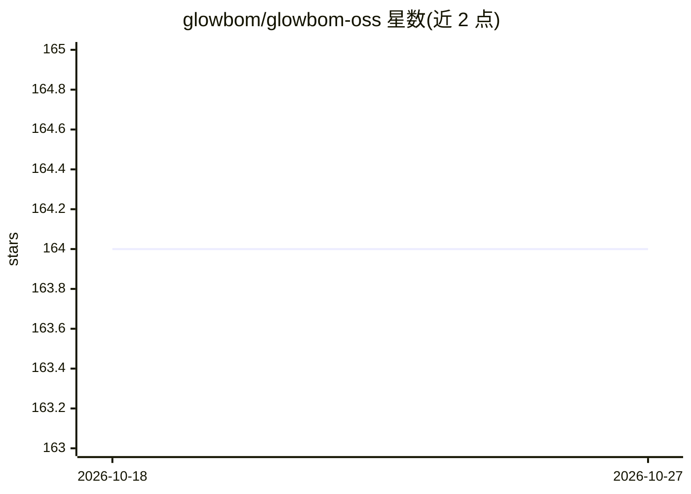

# glowbom/glowbom-oss

⭐ 164 · Go · MIT · 推送 2026-10-18 · [GitHub](https://github.com/glowbom/glowbom-oss) · [官网](https://glowbom.com) · 组织维护

**本地运行编码代理的开源后端、CLI 与浏览器界面**

开源项目，提供后端、CLI、项目模板与浏览器界面，用于打开本地项目、描述变更、审查编码代理的工作并预览结果。支持接入 OpenCode、Codex、Claude Code、Cursor 等编码代理，并可经 Agent Client Protocol（ACP）连接 Cline、Goose 等其他已安装代理。项目文件保留在本机，服务运行于回环地址并以本地访问令牌保护后端。需安装 Go 与 Bun 从源码运行，支持 macOS、Linux 或 Windows WSL。同仓库还以发布资产形式托管闭源的 Glowbom Live 应用。

## 筛选速览

| 维度 | 判定 | 备注 |
|---|---|---|
| AI 角色 | `ai-ecosystem` | LLM/agent 周边工具 |
| 许可风险 | `permissive` | MIT |
| 部署形态 | `None` |  |
| 模型依赖 | — | README 未给出锁定关系 |
| 硬件要求 | — | 无带数字的原话,不猜 |
| 安装摩擦 | `low` | 无编译、无系统依赖或容器化 |
| 成熟度 | — | 结构信号不足 |

## 能力要点

- 接入 OpenCode、Codex、Claude Code、Cursor 等编码代理
- 通过 ACP 手动添加最多三个其他已安装代理连接
- 项目文件保留在本机，后端以本地访问令牌保护
- 提供 CLI、项目模板与浏览器界面，从源码运行

## 适用场景

- 在本地用自选编码代理构建和修改项目
- 审查代理的改动并预览结果
- 把多个已安装的编码代理接到统一界面使用

## 场景标签

`编码 Agent` · 领域:编码与开发

## 证据(README 行号)

> L3: **Build local projects with the coding agents you choose.**
> L25: Install and sign in to at least one agent before your first Build. Each agent
> L40: Agent Client Protocol (ACP) lets Glowbom connect to other installed coding

## 星数曲线

2026-10-18 164 → 2026-10-27 164（+0）

---
*卡片 v1 · prompt 1.4 · 生成 2026-10-22 · 置信度 high · 依据 README sha `3873b60da457` · [字段定义](../../DATASET.md)*
