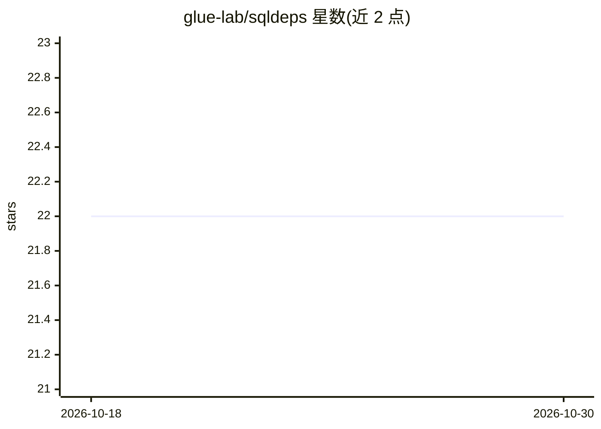

# glue-lab/sqldeps

⭐ 22 · Python · MIT · 推送 2025-12-05 · [GitHub](https://github.com/glue-lab/sqldeps) · [官网](https://sqldeps.readthedocs.io/en/latest) · 组织维护

**用 LLM 自动提取并可视化 SQL 依赖关系的工具**

SQLDeps 分析 SQL 脚本，识别执行前必须存在的表和列（依赖）以及被查询创建或修改的表和列（输出），过滤 CTE 与派生表等临时结构。LLM 解析默认经 litellm 框架调用 openai/gpt-4.1，支持 Groq、OpenAI、DeepSeek 模型并需配置对应 API key。提供 Python API、CLI 与 Streamlit 演示网页三种使用方式，可将结果与数据库 schema 匹配取回列类型，并内置依赖图可视化。

## 筛选速览

| 维度 | 判定 | 备注 |
|---|---|---|
| AI 角色 | `ai-native` | 本体是模型或模型工具 |
| 许可风险 | `permissive` | MIT |
| 部署形态 | `library` | 以包/库形式分发 |
| 模型依赖 | — | README 未给出锁定关系 |
| 硬件要求 | — | 无带数字的原话,不猜 |
| 安装摩擦 | `low` | 无编译、无系统依赖或容器化 |
| 成熟度 | — | 结构信号不足 |

## 能力要点

- 提取 SQL 依赖（前置表/列）与输出（创建/修改的表/列），自动排除 CTE 与派生表
- 经 litellm 框架调用 LLM，支持 Groq/OpenAI/DeepSeek 模型与自定义提示词
- 提供 API、CLI 与 Streamlit 网页三种接口
- 结果可与 PostgreSQL 等数据库 schema 匹配获取列类型，内置依赖图可视化

## 适用场景

- 改动表结构前确认真实依赖，降低破坏风险
- 数据迁移时精确确定需迁移的表和列
- 为项目生成数据库依赖文档与依赖图

## 场景标签

 · 领域:数据工程/SQL 分析工具

## 证据(README 行号)

> L21: A tool that automatically extracts and maps SQL dependencies and outputs using Large Language Models (LLMs).
> L30: 1. **Dependencies**: Tables and columns that must exist BEFORE query execution
> L31: 2. **Outputs**: Tables and columns permanently CREATED or MODIFIED by the query

## 星数曲线

2026-10-18 22 → 2026-10-30 22（+0）

---
*卡片 v1 · prompt 1.4 · 生成 2026-10-27 · 置信度 high · 依据 README sha `485ea9d9e936` · [字段定义](../../DATASET.md)*
