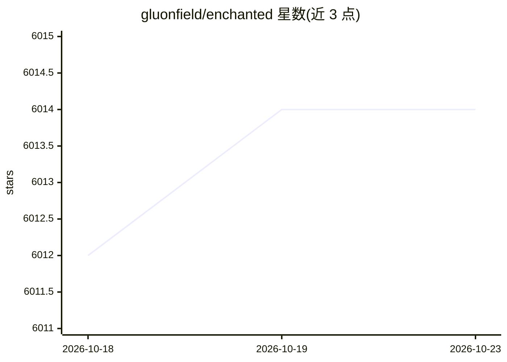

# gluonfield/enchanted

⭐ 6,014 · Swift · Apache-2.0 · 推送 2026-07-07 · [GitHub](https://github.com/gluonfield/enchanted) · 个人维护

**macOS/iOS/visionOS 上连接私有 Ollama 模型的聊天客户端**

Swift 编写的 Apple 平台应用，提供类似 ChatGPT 的对话界面，通过用户自建的 Ollama 服务器（v0.1.14+）访问 Llama 2、Mistral、Vicuna 等私有模型。功能含对话历史（本地存储）、Markdown 渲染、语音提示、图像附件、系统提示词、TTS 朗读、Spotlight 面板（Ctrl+⌘+K）与离线使用；需自行运行 Ollama 服务器，可通过 App Store 下载或本机 Ollama 配合 ngrok 暴露端点。README 声明本项目的新迭代为 Jaz。

## 筛选速览

| 维度 | 判定 | 备注 |
|---|---|---|
| AI 角色 | `ai-ecosystem` | LLM/agent 周边工具 |
| 许可风险 | `permissive` | Apache-2.0 |
| 部署形态 | `None` |  |
| 模型依赖 | local-ok | 支持本地模型 |
| 硬件要求 | — | 无带数字的原话,不猜 |
| 安装摩擦 | `low` | 无编译、无系统依赖或容器化 |
| 成熟度 | — | 结构信号不足 |

## 能力要点

- 连接自建 Ollama 服务器的 ChatGPT 风格对话界面
- 对话历史存储在设备本地，全功能可离线使用
- 支持图像附件、语音提示、TTS 朗读与系统提示词
- macOS Spotlight 快捷面板 Ctrl+⌘+K

## 适用场景

- 在 Apple 设备上使用自己托管的 LLM 聊天
- 本地私有化保存对话历史
- 跨 macOS/iOS/visionOS 使用同一套私有模型

## 场景标签

`聊天机器人` · 领域:对话与助手

## 证据(README 行号)

> L13: Enchanted is an open source, Ollama compatible, elegant macOS/iOS/visionOS app for working with privately hosted mo
> L19: Note: You will need to run your own Ollama server to use the app. Read instructions below.
> L84: Enchanted requires Ollama v0.1.14 or later.

## 星数曲线

2026-10-18 6,012 → 2026-10-23 6,014（+2）

---
*卡片 v1 · prompt 1.4 · 生成 2026-10-20 · 置信度 high · 依据 README sha `5f014a71cc0a` · [字段定义](../../DATASET.md)*
