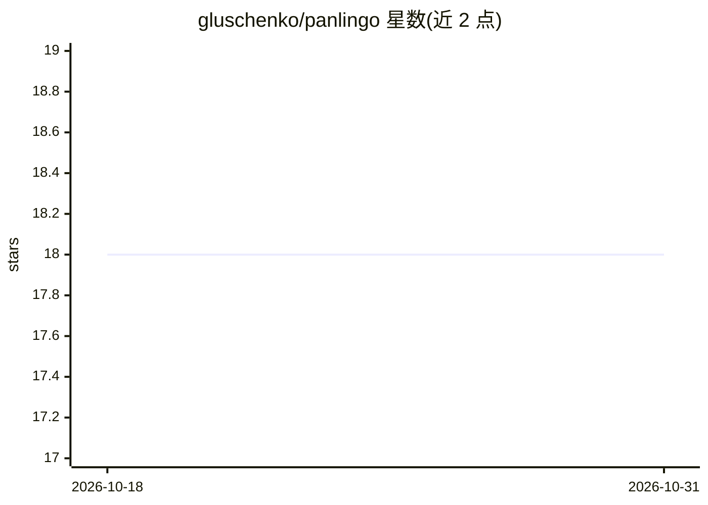

# gluschenko/panlingo

⭐ 18 · C# · NOASSERTION · 推送 2026-09-12 · [GitHub](https://github.com/gluschenko/panlingo) · 个人维护

**.NET 语言识别库合集：6 种模型的原生互操作封装**

面向 .NET 开发者的语言检测库集合，通过互操作封装 CLD2、CLD3、FastText、Whatlang、MediaPipe、Lingua 六种模型，以 NuGet 包分发。各库能力不同：支持语言数从 69 到 217 不等，部分支持多语言预测与未知语言检测，算法涵盖 n-gram 与神经网络。原始代码以子模块形式使用、不修改行为。平台支持按库而异，如 Lingua 仅支持 Linux x86_64、Windows x86_64 与 macOS arm64。

## 筛选速览

| 维度 | 判定 | 备注 |
|---|---|---|
| AI 角色 | `ai-native` | 本体是模型或模型工具 |
| 许可风险 | `none` | NOASSERTION |
| 部署形态 | `self-host` | docker 或自建部署 |
| 模型依赖 | — | README 未给出锁定关系 |
| 硬件要求 | — | 无带数字的原话,不猜 |
| 安装摩擦 | `low` | 无编译、无系统依赖或容器化 |
| 成熟度 | — | 结构信号不足 |

## 能力要点

- 六种语言识别模型统一封装为 NuGet 包
- 原始库代码以子模块方式使用，不改变原有行为
- 各库支持语言数从 69 到 217 不等，含能力对比表
- 提供平台支持矩阵（Linux/Windows/macOS，x86_64 与 arm64）

## 适用场景

- 在 .NET 应用中集成文本语言检测
- 对比多种语言识别模型选择合适的封装
- 需要脚本检测或多语言预测的场景选用 FastText/MediaPipe 等对应库

## 场景标签

 · 领域:NLP/开发库

## 证据(README 行号)

> L9: This project presents a comprehensive collection of language identification
> L50: |**Single language prediction**|Yes|Yes|Yes|Yes|Yes|Yes|

## 星数曲线

2026-10-18 18 → 2026-10-31 18（+0）

---
*卡片 v1 · prompt 1.4 · 生成 2026-10-29 · 置信度 high · 依据 README sha `5ff26d137b70` · [字段定义](../../DATASET.md)*
