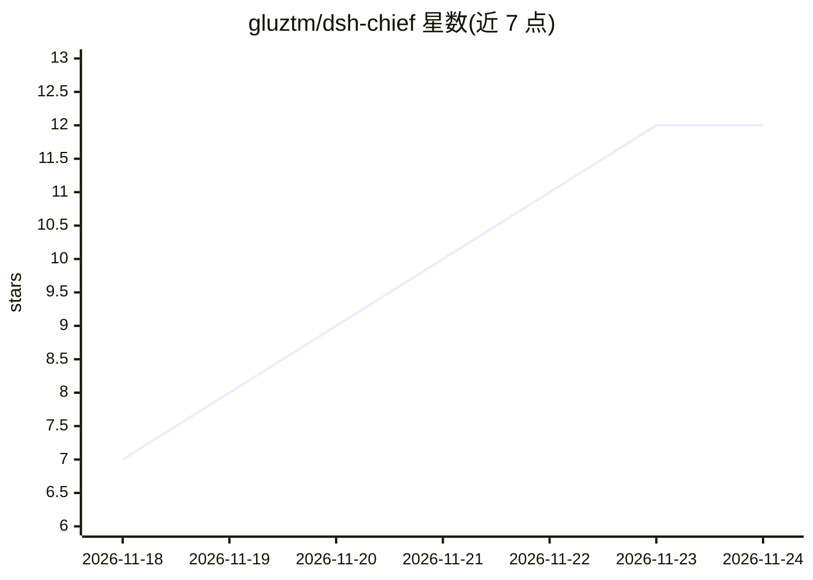

# gluztm/dsh-chief

⭐ 12 · JavaScript · AGPL-3.0 · 推送 2026-11-23 · [GitHub](https://github.com/gluztm/dsh-chief) · [官网](https://awesome-dsh-plugin.com/p/gluztm/dsh-chief/) · 个人维护 · 中文 README

**DeepSeek Harness 的多代理看护面板：压缩防丢、权限审批、子代理监控**

面向 DeepSeek Harness（DSH）宿主的常驻侧边栏插件：在 /compact 前先把参数与路径写入本地档案柜再压缩；提供只读到高自主四档权限与事前物理驻墙，工具调用前拦截高危命令；以树状卡片展示主/子代理进度并支持熔断急停；跨窗口交接单与 0-Token 三层冷档案柜避免重复注入上下文。通过 dshmarket 或 npm 安装，注册 4 个结构化工具给模型调用，状态全部留在本地且零遥测。

## 筛选速览

| 维度 | 判定 | 备注 |
|---|---|---|
| AI 角色 | `ai-ecosystem` | LLM/agent 周边工具 |
| 许可风险 | `viral` | AGPL-3.0 |
| 部署形态 | `None` |  |
| 模型依赖 | — | README 未给出锁定关系 |
| 硬件要求 | — | 无带数字的原话,不猜 |
| 安装摩擦 | `low` | 无编译、无系统依赖或容器化 |
| 成熟度 | — | 结构信号不足 |

## 能力要点

- 压缩前先落盘校验，封存时向主对话注入 0 Token
- 四档权限与事前物理驻墙，硬红线（删盘/强推等）任何档位直接拦截
- 主/子代理任务树与实时推理流分屏、急停熔断
- 三层本地冷档案柜与跨会话 Markdown 交接单

## 适用场景

- 长会话压缩后不再丢配置路径和回滚命令
- 无人值守跑多步改动时锁定验收标准并自动续推
- 多个子代理并行时一屏看进度、拦失控任务
- 权限敏感环境下逐项审批改文件与跑命令

## 场景标签

`多智能体` · 领域:Agent 开发

## 证据(README 行号)

> L1: **给 DeepSeek Harness（DSH）用的右侧栏任务看护、防压缩忘事与权限管控面板**
> L11: ### DeepSeek Harness 右侧常驻多代理看护、0-Token 本地档案柜与安全审批面板
> L50:  - **工具落地前的事前物理驻墙**：主对话、子代理和参谋只要调用终端命令或读写文件，执行前都要先过宿主 `tools/pre-execute` 检查和你的「物理驻墙」。每堵墙都能切成「全局随身（像偏好一样跟着所有新对话）」、「

## 星数曲线

2026-11-18 7 → 2026-11-24 12（+5）

---
*卡片 v1 · prompt 1.4 · 生成 2026-11-20 · 置信度 high · 依据 README sha `c8c43c0b4820` · [字段定义](../../DATASET.md)*
