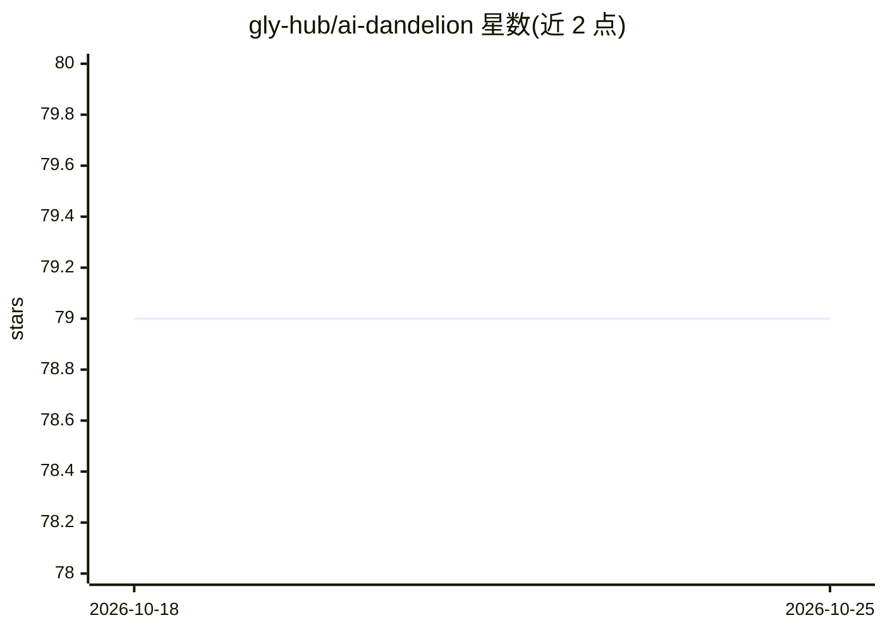

# gly-hub/ai-dandelion

⭐ 79 · Go · MIT · 推送 2026-09-04 · [GitHub](https://github.com/gly-hub/ai-dandelion) · [官网](https://blog.mrgogh.work) · 个人维护 · 中文 README

**构建与运行 AI 辅助业务功能的多服务后端**

面向 AI 辅助业务应用的多服务后端：由 HTTP 网关（inner-gateway）、AI agent 服务（会话/技能/MCP 配置/执行）、函数生命周期服务（生成应用制品与发布）、系统服务（用户/角色/模型配置）四个 gRPC 服务组成，共享 proto 契约与 toolbox 公共库。前端为独立仓库 ai-dandelion-web（React+Vite）。需 Redis、etcd、本地 rtk 命令包装器，按顺序以 rtk go run 启动各服务。仓库未声明许可证。

## 筛选速览

| 维度 | 判定 | 备注 |
|---|---|---|
| AI 角色 | `ai-ecosystem` | LLM/agent 周边工具 |
| 许可风险 | `permissive` | MIT |
| 部署形态 | `library` | 以包/库形式分发 |
| 模型依赖 | — | README 未给出锁定关系 |
| 硬件要求 | — | 无带数字的原话,不猜 |
| 安装摩擦 | `low` | 无编译、无系统依赖或容器化 |
| 成熟度 | — | 结构信号不足 |

## 能力要点

- 四服务架构：网关 + AI agent + 函数生命周期 + 系统管理
- AI agent 执行含会话、技能与 MCP server 配置
- 生成应用制品的发布与运行时支持（执行不可信业务代码）
- 网关承担认证边界、WebSocket 实时入口与 HTTP-to-gRPC 适配

## 适用场景

- 自托管运行配套 Web 应用的 AI agent 业务后端
- 管理 AI 会话、技能与 MCP server 配置
- 发布与运行 AI 生成的业务应用制品

## 场景标签

`Agent 框架` `代码生成` · 领域:Agent 开发

## 证据(README 行号)

> L3: AI Dandelion is a multi-service backend for building and operating AI-assisted business functions. It provides the H
> L39: |`ai-agent/`|AI conversations, sessions, skills, MCP server configuration, and agent execution.|

## 星数曲线

2026-10-18 79 → 2026-10-25 79（+0）

---
*卡片 v1 · prompt 1.4 · 生成 2026-10-24 · 置信度 low · 依据 README sha `ac47aeb56852` · [字段定义](../../DATASET.md)*
