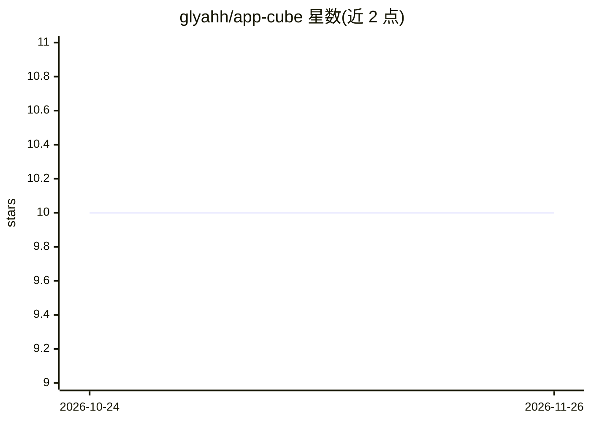

# glyahh/app-cube

⭐ 10 · Java · MIT · 推送 2026-10-29 · [GitHub](https://github.com/glyahh/app-cube) · 个人维护 · 中文 README

**Java 技术栈的 AI 应用代码生成与发布平台**

基于 Java 21、Spring Boot、LangChain4j 与 LangGraph4j 的应用生成平台：接收用户自然语言描述，经模型与工作流生成 Vue 项目代码，再经 SFC 解析、构建验证、Elasticsearch 代码检索与发布，交付可访问的 Web 应用制品。工程机制包括 SSE 流式工具事件处理、MySQL+Redis 分层会话记忆与版本同步、KNN+BM25 代码 RAG、iframe 可视化编辑及 deployKey 静态制品发布。README 未提供吞吐量或生产可用性结论。

## 筛选速览

| 维度 | 判定 | 备注 |
|---|---|---|
| AI 角色 | `ai-native` | 本体是模型或模型工具 |
| 许可风险 | `permissive` | MIT |
| 部署形态 | `library` | 以包/库形式分发 |
| 模型依赖 | — | README 未给出锁定关系 |
| 硬件要求 | — | 无带数字的原话,不猜 |
| 安装摩擦 | `medium` | 含编译或系统依赖之一 |
| 成熟度 | — | 结构信号不足 |

## 能力要点

- SSE 流式返回模型文本与工具事件，支持普通链路与 LangGraph4j 工作流链路
- MySQL 保存完整历史、Redis 保存上下文窗口的分层会话记忆
- 代码切块写入 Elasticsearch，KNN+BM25 检索减少重复生成
- Vue 构建验证：发布前经 SFC 解析、修复与 npm run build 验收

## 适用场景

- 用自然语言描述生成可预览、可修改的 Web 应用
- 对生成的 Vue 项目做构建验证后再发布
- 通过 deployKey 访问和撤回已发布的应用制品

## 场景标签

`代码生成` `RAG` · 领域:编码与开发

## 证据(README 行号)

> L15: 这是一个基于 Java、Spring Boot、LangChain4j 和 LangGraph4j 的 AI 应用生成平台。
> L17: 系统接收用户对应用的描述，通过模型和工作流生成项目代码，再经过解析、保存、检索、构建检查和发布，形成可以访问的 Web 应用制品。
> L25: 通过 SSE 返回模型文本、工具请求和工具执行事件，支持普通生成链路和 LangGraph4j 工作流链路。

## 星数曲线

2026-10-24 10 → 2026-11-26 10（+0）

---
*卡片 v1 · prompt 1.4 · 生成 2026-11-19 · 置信度 high · 依据 README sha `b6132bf4b610` · [字段定义](../../DATASET.md)*
