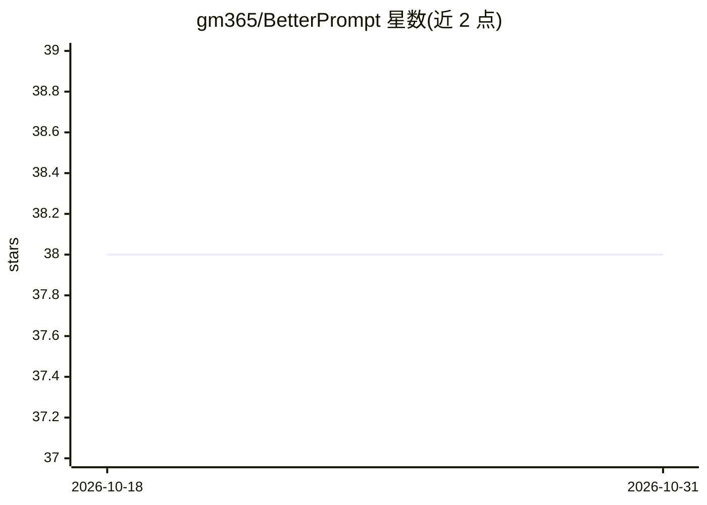

# gm365/BetterPrompt

⭐ 38 · JavaScript · MIT · 推送 2026-03-05 · [GitHub](https://github.com/gm365/BetterPrompt) · [官网](https://bp.upsui.com) · 个人维护 · 中文 README

**Chrome 插件：调用 Gemini API 一键优化网页内 Prompt 提示词**

Chrome 浏览器扩展，调用 Google Gemini API（Flash Lite 或 Flash）对用户输入的 Prompt 进行优化、改写与增强。核心机制：在任意网页可编辑区域连续按三次空格触发内联优化并替换原文，或使用独立的优化器页面做精细调整；支持默认、简洁、详细等优化风格与自定义系统提示词。用户需自行配置 Gemini API 密钥（仅存储于本地），插件需以开发者模式从源码加载。另有独立网站 bp.upsui.com 提供在线优化，且更新将优先应用于独立站。

## 筛选速览

| 维度 | 判定 | 备注 |
|---|---|---|
| AI 角色 | `ai-native` | 本体是模型或模型工具 |
| 许可风险 | `permissive` | MIT |
| 部署形态 | `None` |  |
| 模型依赖 | — | README 未给出锁定关系 |
| 硬件要求 | — | 无带数字的原话,不猜 |
| 安装摩擦 | `low` | 无编译、无系统依赖或容器化 |
| 成熟度 | — | 结构信号不足 |

## 能力要点

- 任意网页输入框内三次空格触发内联 Prompt 优化
- 独立优化器页面支持输入、优化与比较不同版本 Prompt
- 多种优化风格（默认/简洁/详细）与自定义系统提示词
- Gemini API 密钥本地存储，可在 Flash Lite 与 Flash 间切换

## 适用场景

- 在与 ChatGPT、Claude 等对话前快速优化我要发送的提示词
- 批量改写长 Prompt 并比较优化前后版本
- 根据场景在简洁与详细风格间切换提示词表达

## 场景标签

`提示工程` · 领域:Agent 开发

## 证据(README 行号)

> L5: **简述:** BetterPrompt 是一款 Chrome 插件，利用 Google Gemini API 帮助用户优化、改写和增强 Prompt，支持通过便捷的快捷键在网页内联优化，或使用专门的优化器页面进行更精细的调整。
> L30: * **🧠 Gemini API 驱动:** 利用强大的 Google Gemini 模型进行 Prompt 改写和增强。

## 星数曲线

2026-10-18 38 → 2026-10-31 38（+0）

---
*卡片 v1 · prompt 1.4 · 生成 2026-10-25 · 置信度 high · 依据 README sha `15e3f3e18c53` · [字段定义](../../DATASET.md)*
