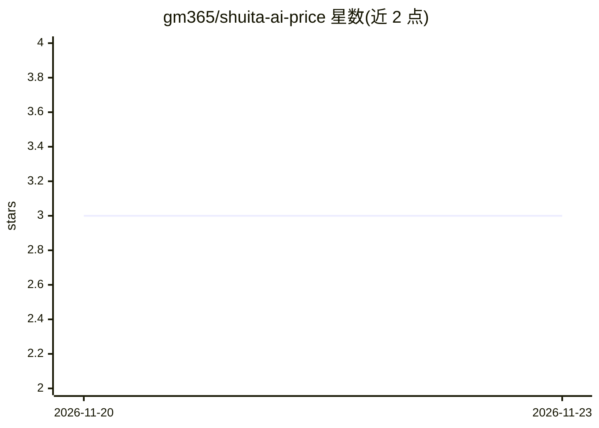

# gm365/shuita-ai-price

⭐ 3 · TypeScript · MIT · 推送 2026-11-22 · [GitHub](https://github.com/gm365/shuita-ai-price) · [官网](https://shuita.xyz) · 个人维护 · 中文 README

**给 AI 助手查询国内渠道 AI 订阅实时价格的 MCP 服务**

连接 AI 助手与水獭 shuita.xyz 行情站的 MCP 服务器与 Agent Skill：追踪 ChatGPT、Claude、Gemini、Grok、Cursor 等订阅与账号在 133 家发卡网店铺、113 个 Telegram Bot 的报价，提供搜索产品、查询最低价、分店报价、30 天走势等 7 个工具。数据每小时更新、每条报价附核验时间，价格为含支付手续费的到手价。无需 API Key，只读公开 JSON 切片，本地缓存 5 分钟；不代下单。需要 Node.js 18+，通过 npx 或复制 Skill 目录接入各 MCP 客户端。

## 筛选速览

| 维度 | 判定 | 备注 |
|---|---|---|
| AI 角色 | `ai-ecosystem` | LLM/agent 周边工具 |
| 许可风险 | `permissive` | MIT |
| 部署形态 | `library` | 以包/库形式分发 |
| 模型依赖 | — | README 未给出锁定关系 |
| 硬件要求 | — | 无带数字的原话,不猜 |
| 安装摩擦 | `low` | 无编译、无系统依赖或容器化 |
| 成熟度 | — | 结构信号不足 |

## 能力要点

- 7 个 MCP 工具：关键词搜索、最低价、分店报价、30 天走势、店铺/品类列表、站点统计
- 覆盖 133 家店铺、113 个 Telegram Bot、73 种产品、约 4,700 条挂牌
- 每条报价附核验时间，到手价含最便宜的支付宝/微信手续费，USDT 价另列
- 同仓库提供 Agent Skill，未装 MCP 时回退读取 llms.txt

## 适用场景

- 在 Claude Code 或 Cursor 里直接问某款 AI 订阅当前最低渠道价
- 查某款产品近 30 天价格走势判断是否低点
- 比较直充、成品号、拼车等不同规格的价差与风险

## 场景标签

 · 领域:信息查询/比价工具

## 证据(README 行号)

> L5:  AI subscription price comparison for AI assistants: MCP server + Agent Skill
> L7:  AI 订阅比价 MCP 与 Skill ：让 Claude、Cursor、Codex 等 AI 助手直接查询 AI 会员的渠道实时价格
> L83: **shuita-ai-price** 是 水獭 shuita.xyz 的官方 MCP 服务与 Agent Skill。水獭追踪 ChatGPT、Claude、Gemini、Grok、Cursor 等 AI 订阅与账号在发卡网、独

## 星数曲线

2026-11-20 3 → 2026-11-23 3（+0）

---
*卡片 v1 · prompt 1.4 · 生成 2026-11-22 · 置信度 high · 依据 README sha `15173004858c` · [字段定义](../../DATASET.md)*
