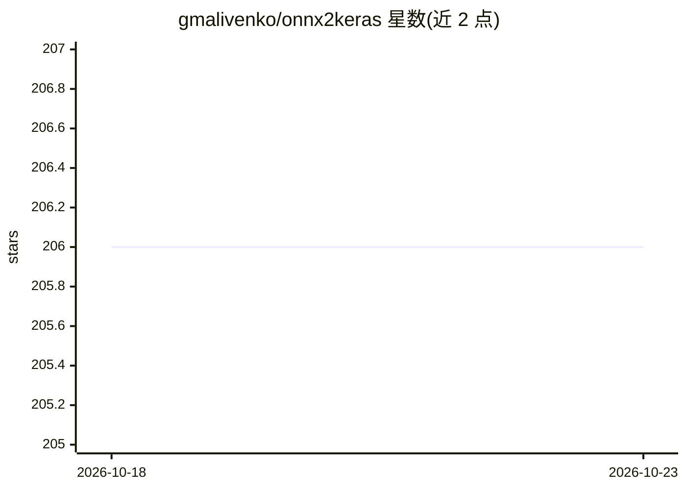

# gmalivenko/onnx2keras

⭐ 206 · Python · MIT · 推送 2026-09-13 · [GitHub](https://github.com/gmalivenko/onnx2keras) · 个人维护

**将 ONNX 模型图转换为 Keras 模型格式的转换库**

Python 库，读取 ONNX 模型图并转换为 Keras（TF.Keras 3）模型，支持通过 ONNX 中间格式间接转换 PyTorch 模型。提供 onnx_to_keras API，可选修改输入布局（change_ordering 到 NHWC）以便在 CPU 运行或导出到 LiteRT/TensorFlow Lite、frozen graph（用于 TensorFlow.js、Android、C-API 部署）。要求 Python 3.10+ 与 TensorFlow 2.16+，已验证 opset 9-23。部分参数（input_shapes、name_policy、change_ordering）标注为实验性。

## 筛选速览

| 维度 | 判定 | 备注 |
|---|---|---|
| AI 角色 | `ai-ecosystem` | LLM/agent 周边工具 |
| 许可风险 | `permissive` | MIT |
| 部署形态 | `library` | 以包/库形式分发 |
| 模型依赖 | — | README 未给出锁定关系 |
| 硬件要求 | — | 无带数字的原话,不猜 |
| 安装摩擦 | `low` | 无编译、无系统依赖或容器化 |
| 成熟度 | `idea` | |

## 能力要点

- ONNX 图到 Keras 模型的转换，支持 opset 9-23
- 经 ONNX 中间格式转换 PyTorch 模型
- 导出 SavedModel 后可转 LiteRT/TensorFlow Lite（builtin ops，无需 Flex delegate）
- change_ordering=True 支持 CPU/移动端 NHWC 布局

## 适用场景

- 把 PyTorch 训练的模型迁移到 TensorFlow/Keras 生态
- 将 ONNX 模型部署为 TensorFlow Lite 移动端模型
- 导出 frozen graph 供 TensorFlow.js 或 TensorFlow C-API 使用

## 场景标签

 · 领域:深度学习工具链/模型转换

## 证据(README 行号)

> L3: ONNX to Keras deep neural network converter.
> L51: Using ONNX as intermediate format, you can convert PyTorch model as well.

## 星数曲线

2026-10-18 206 → 2026-10-23 206（+0）

---
*卡片 v1 · prompt 1.4 · 生成 2026-10-22 · 置信度 high · 依据 README sha `b29211334877` · [字段定义](../../DATASET.md)*
