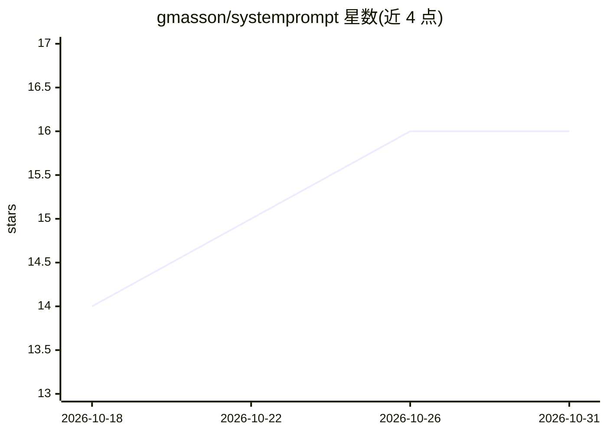

# gmasson/systemprompt

⭐ 16 · MIT · 推送 2026-05-11 · [GitHub](https://github.com/gmasson/systemprompt) · [官网](https://github.com/gmasson/systemprompt/) · 个人维护

**通用系统提示词模板：让 LLM 回答更严谨诚实的两版提示文本**

以 Markdown 文件形式提供的通用系统提示词资产，含完整版与压缩到 1,500 字符以内的精简版，分别适用于支持长系统提示的界面与仅开放简短自定义指令字段（如 custom instructions/persona）的平台。内容为 12 条行为指令（反迎合、根因思考、事实精确性区分等），使用方式是粘贴到系统提示字段，或经 API 作为 system 消息传入 Anthropic/OpenAI 兼容接口。README 声明其不锁定领域、不能覆盖更高优先级的平台与安全规则，且不使事实性声明自动可靠。MIT 许可。

## 筛选速览

| 维度 | 判定 | 备注 |
|---|---|---|
| AI 角色 | `ai-knowledge` | 知识聚合/清单类 |
| 许可风险 | `permissive` | MIT |
| 部署形态 | `None` |  |
| 模型依赖 | — | README 未给出锁定关系 |
| 硬件要求 | — | 无带数字的原话,不猜 |
| 安装摩擦 | `low` | 无编译、无系统依赖或容器化 |
| 成熟度 | — | 结构信号不足 |

## 能力要点

- 提供完整版与 ≤1,500 字符精简版两套提示文本
- 12 条行为指令：反迎合、根因思考、事实/推断/不确定区分等
- 支持粘贴到系统提示字段或经 API 作为 system 消息传入
- 不锁定领域，声明无法覆盖更高优先级的平台与安全规则

## 适用场景

- 给常用 AI 对话界面配置更严谨的自定义指令
- 在 API 调用中加入通用系统提示改善回答行为
- 字符受限平台使用精简版提示

## 场景标签

`提示工程` · 领域:Agent 开发

## 证据(README 行号)

> L15: |File|Best use|
> L17: |`SystemPrompt.md`|Full version with headings, explanations, and clearer separation between directives. Use when th
> L18: |`SystemPrompt.min.md`|Compact version for AI interfaces with strict customization limits. It preserves the same be

## 星数曲线

2026-10-18 14 → 2026-10-31 16（+2）

---
*卡片 v1 · prompt 1.4 · 生成 2026-10-30 · 置信度 high · 依据 README sha `73fafc35230a` · [字段定义](../../DATASET.md)*
