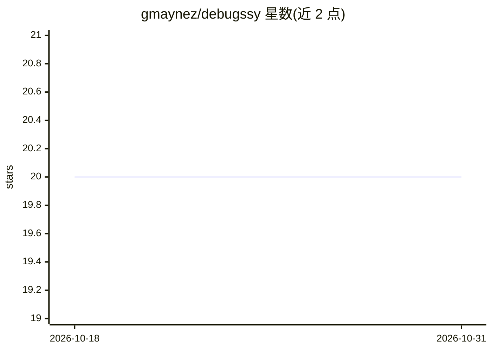

# gmaynez/debugssy

⭐ 20 · TypeScript · Apache-2.0 · 推送 2026-10-24 · [GitHub](https://github.com/gmaynez/debugssy) · [官网](https://marketplace.visualstudio.com/items?itemName=gamag.debugssy) · 个人维护

**让 AI 助手通过 MCP 操作 VS Code 调试器的扩展**

VS Code 扩展，随扩展启动一个本地 Streamable HTTP MCP 服务器（默认 localhost:3000/mcp），把编辑器的调试器能力暴露给 MCP 客户端：设置/管理断点、读取变量/调用栈/线程/控制台输出、求值表达式；full 模式还提供启动/停止/继续/单步等执行工具。面向使用 Copilot、Cursor、Claude Code、OpenCode 等 MCP 客户端的开发者。语言能力取决于已安装的 debug adapter，默认 assisted 模式由用户控制执行。含 Zod 参数校验与表达式风险分级验证。

## 筛选速览

| 维度 | 判定 | 备注 |
|---|---|---|
| AI 角色 | `ai-ecosystem` | LLM/agent 周边工具 |
| 许可风险 | `permissive` | Apache-2.0 |
| 部署形态 | `None` |  |
| 模型依赖 | — | README 未给出锁定关系 |
| 硬件要求 | — | 无带数字的原话,不猜 |
| 安装摩擦 | `low` | 无编译、无系统依赖或容器化 |
| 成熟度 | — | 结构信号不足 |

## 能力要点

- 通过 MCP 暴露断点、变量/调用栈/控制台读取与表达式求值工具
- assisted/full 两种模式，full 模式提供执行控制工具（启动/停止/单步等）
- 支持 VS Code Copilot、Cursor、Claude Code、OpenCode 等客户端接入
- 本地 Streamable HTTP 端点，含表达式长度与风险分级验证

## 适用场景

- 调试时让 AI 助手设置断点、查看变量与调用栈
- 让助手在 full 模式下自动启动调试会话并单步跟踪
- 配合 Claude Code / Cursor / Copilot 等已有 MCP 客户端做调试辅助

## 场景标签

`编码 Agent` · 领域:编码与开发

## 证据(README 行号)

> L11: Debugssy connects an MCP client to VS Code's debugger through the
> L12: Model Context Protocol. The assistant can set

## 星数曲线

2026-10-18 20 → 2026-10-31 20（+0）

---
*卡片 v1 · prompt 1.4 · 生成 2026-10-28 · 置信度 high · 依据 README sha `7ad399a51a18` · [字段定义](../../DATASET.md)*
