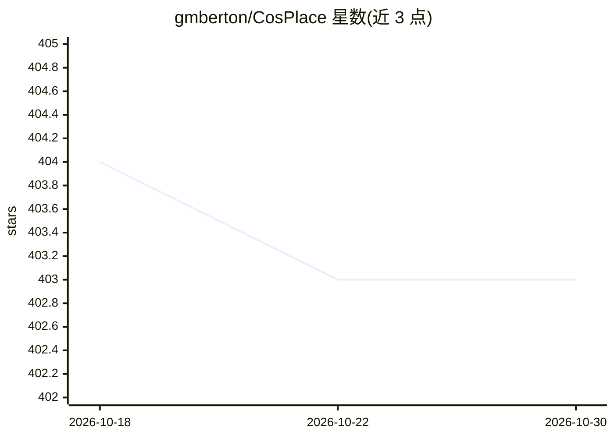

# gmberton/CosPlace

⭐ 403 · Python · MIT · 推送 2026-03-15 · [GitHub](https://github.com/gmberton/CosPlace) · 个人维护

**CVPR 2022 视觉地理定位方法 CosPlace 官方 PyTorch 实现**

论文官方代码库：提供 CosPlace 训练方法与 SF-XL 数据集，用于大规模视觉位置识别，产出图像描述子并检索匹配地理位置。训练脚本自动将 SF-XL 划分为 CosPlace Groups，默认 ResNet-18、512 维描述子，显存占用少于 4GB；支持更换骨干网络、AMP 混合精度，提供 eval.py 测试与预测可视化。训练模型可经 PyTorch Hub 加载，或下载 ResNet-18/50/101/152 与 VGG-16 各维度权重。SF-XL 全量约 1TB，另有 360GB 子集与 5GB 轻量版（仅供调试）。README 注明本方法已较旧并指向 MegaLoc。

## 筛选速览

| 维度 | 判定 | 备注 |
|---|---|---|
| AI 角色 | `ai-native` | 本体是模型或模型工具 |
| 许可风险 | `permissive` | MIT |
| 部署形态 | `None` |  |
| 模型依赖 | — | README 未给出锁定关系 |
| 硬件要求 | — | 无带数字的原话,不猜 |
| 安装摩擦 | `low` | 无编译、无系统依赖或容器化 |
| 成熟度 | — | 结构信号不足 |

## 能力要点

- CosPlace 训练方法：自动划分 CosPlace Groups，默认 ResNet-18 + 512 维描述子
- 训练模型支持 PyTorch Hub 一行加载，含多骨干/多维度权重下载表
- eval.py 支持测试与预测可视化（可只保存错误预测）
- SF-XL 数据集提供 1TB 全量、360GB 子集与 5GB 轻量版

## 适用场景

- 在 SF-XL 数据集上训练视觉位置识别模型
- 通过 PyTorch Hub 在自有代码中直接加载预训练地理定位模型
- 复现 CVPR 2022 论文结果并与自身方法对比

## 场景标签

 · 领域:计算机视觉/地理定位

## 证据(README 行号)

> L3: This is the official pyTorch implementation of the CVPR 2022 paper "Rethinking Visual Geo-localization for Large-Sca
> L18: `$ python3 train.py --train_set_folder path/to/sf_xl/raw/train/database --val_set_folder path/to/sf_xl/processed/va
> L21: By default training is performed with a ResNet-18 with descriptors dimensionality 512, which fits in less than 4GB 

## 星数曲线

2026-10-18 404 → 2026-10-30 403（-1）

---
*卡片 v1 · prompt 1.4 · 生成 2026-10-21 · 置信度 high · 依据 README sha `fffbc9aa0b19` · [字段定义](../../DATASET.md)*
