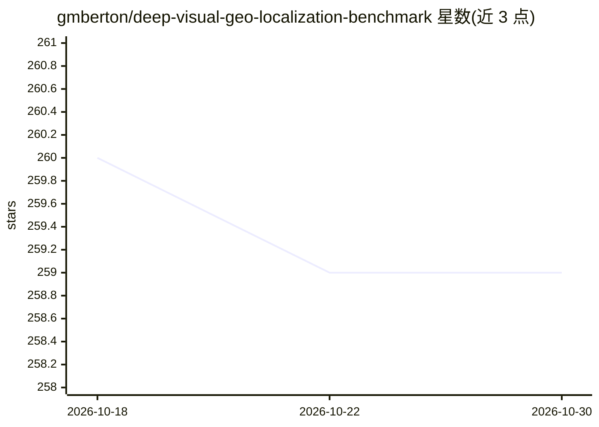

# gmberton/deep-visual-geo-localization-benchmark

⭐ 259 · Python · MIT · 推送 2026-03-15 · [GitHub](https://github.com/gmberton/deep-visual-geo-localization-benchmark) · 个人维护

**视觉地理定位基准工具箱：训练/评测多组合的 VPR 流水线**

CVPR 2022 Oral 论文 Deep Visual Geo-localization Benchmark 的官方代码库。提供一个 PyTorch 工具箱，用于复现论文结果并组合视觉地理定位流水线的各组件：可切换骨干网络（VGG/ResNet/ViT/CCT）、聚合方法（GeM/NetVLAD/CRN）、挖矿策略与多种测试前后处理；支持 PCA 降维、数据增强、自定义召回阈值与 R@N。配套 Model Zoo 列出约 30 个按不同配置训练的预训练模型下载链接，数据集需按指定目录结构组织并由配套下载仓库获取。

## 筛选速览

| 维度 | 判定 | 备注 |
|---|---|---|
| AI 角色 | `ai-ecosystem` | LLM/agent 周边工具 |
| 许可风险 | `permissive` | MIT |
| 部署形态 | `None` |  |
| 模型依赖 | — | README 未给出锁定关系 |
| 硬件要求 | — | 无带数字的原话,不猜 |
| 安装摩擦 | `low` | 无编译、无系统依赖或容器化 |
| 成熟度 | — | 结构信号不足 |

## 能力要点

- 可自由组合骨干网络、聚合方法与挖矿策略的 VPR 训练/评测工具箱
- 复现论文表 3/4/5 与补充材料表 2/3/4 的全部结果
- Model Zoo 提供不同骨干/聚合/挖矿方法的预训练模型下载
- 支持自动下载并使用 radenovic 与 naver 仓库的地标识别预训练模型

## 适用场景

- 复现论文中各视觉地理定位方法的基准结果
- 在自有数据集上评测或训练地理定位描述子模型
- 对比不同骨干网络与聚合方法的召回率表现

## 场景标签

`模型评测` `模型训练` · 领域:评测与运维

## 证据(README 行号)

> L2: This is the official repository for the CVPR 2022 Oral paper Deep Visual Geo-localization Benchmark.
> L3: It can be used to reproduce results from the paper, and to compute a wide range of experiments, by changing the comp

## 星数曲线

2026-10-18 260 → 2026-10-30 259（-1）

---
*卡片 v1 · prompt 1.4 · 生成 2026-10-22 · 置信度 high · 依据 README sha `211acac8084d` · [字段定义](../../DATASET.md)*
