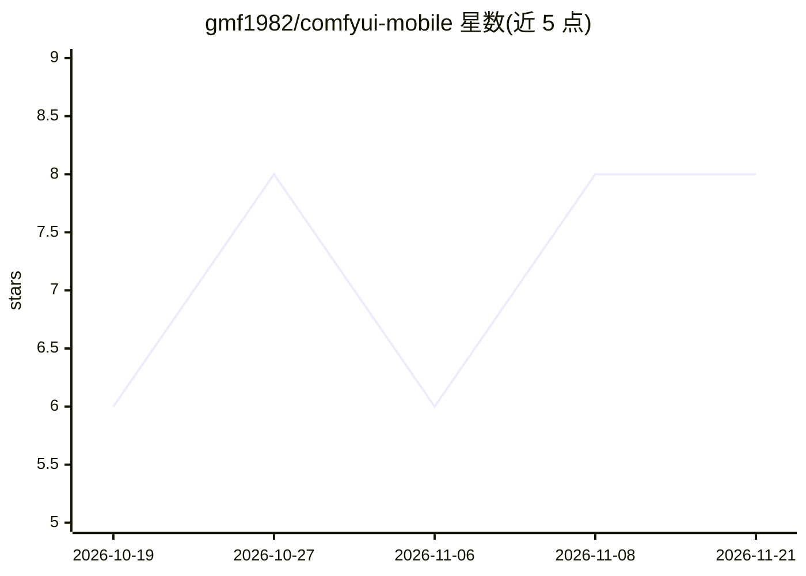

# gmf1982/comfyui-mobile

⭐ 8 · JavaScript · MIT · 推送 2026-11-11 · [GitHub](https://github.com/gmf1982/comfyui-mobile) · 个人维护 · 中文 README

**手机端操作 PC ComfyUI 的零安装移动网页界面**

在电脑上运行一个 Node.js 安全网关，手机通过浏览器打开网页即可操作本机的 ComfyUI，手机端无需安装任何应用，可通过「添加到主屏幕」以 PWA 形式使用。网关将工作流自动推导为移动端参数表单，提供工作流管理、模板库、图库、队列监控、手机端节点图编辑，以及基于 Tailscale 的外网访问隧道和 ComfyUI 远程启动/重启。访问控制包括令牌鉴权、防爆破封禁与写操作限流。前提是电脑上已有一套可运行的 ComfyUI 及 Node.js ≥ 20。

## 筛选速览

| 维度 | 判定 | 备注 |
|---|---|---|
| AI 角色 | `ai-ecosystem` | LLM/agent 周边工具 |
| 许可风险 | `permissive` | MIT |
| 部署形态 | `desktop` | 安装包/桌面程序 |
| 模型依赖 | — | README 未给出锁定关系 |
| 硬件要求 | — | 无带数字的原话,不猜 |
| 安装摩擦 | `low` | 无编译、无系统依赖或容器化 |
| 成熟度 | — | 结构信号不足 |

## 能力要点

- 工作流自动推导为手机友好的参数表单（提示词/分辨率/采样器等）
- 图库支持保存、分享与用原参数一键重跑
- 内置 Tailscale 一键隧道与 ComfyUI 远程启动/重启
- 令牌鉴权、防爆破封禁、写操作限流、路径穿越校验

## 适用场景

- 在沙发或出门在外时用手机操作电脑上的 ComfyUI 出图
- 把 ComfyUI 工作流变成大按钮表单给不熟悉节点连线的家人用
- 外网环境下通过 Tailscale 访问家里的 ComfyUI
- 在手机上查看生成队列进度与显存占用并随时中断

## 场景标签

`图像生成` · 领域:内容生成

## 证据(README 行号)

> L9: 在手机上轻松使用**电脑里的 ComfyUI**：电脑上运行一个轻量**安全网关**，手机打开网页即可操作，手机上什么都不用装。无论是窝在沙发上还是出门在外，都能随时出图：工作流自动推导成大按钮参数表单，**抛开桌面端眼花缭乱的节点
> L46: > 前提：电脑上已有一套能正常运行的 ComfyUI（浏览器能打开 `http://127.0.0.1:8188` 即可；实测版本 0.37.0，兼容新旧两种接口路径），以及 Node.js ≥ 20。

## 星数曲线

2026-10-19 6 → 2026-11-21 8（+2）

---
*卡片 v1 · prompt 1.4 · 生成 2026-11-20 · 置信度 high · 依据 README sha `5478a134de55` · [字段定义](../../DATASET.md)*
