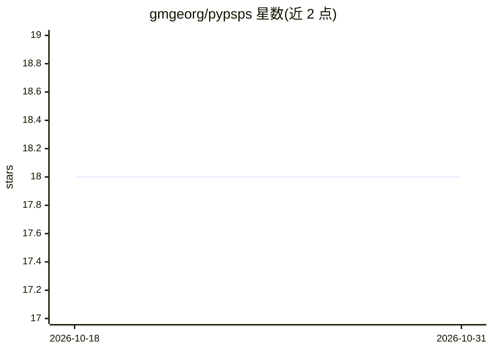

# gmgeorg/pypsps

⭐ 18 · Jupyter Notebook · MIT · 推送 2026-08-29 · [GitHub](https://github.com/gmgeorg/pypsps) · 个人维护

**因果深度学习库：用预测状态倾向分层估计观测数据因果效应**

将 Kelly, Kong, Goerg (2022) 提出的 PSPS 因果推断算法实现为 TensorFlow/Keras 的自定义层、损失函数与指标，用于观测（非随机化）数据的处理效应估计。通过中间预测状态分解联合分布，在训练结局模型的同时学习倾向得分分层以保证层内均衡。支持二元/连续/多类处理与多种结局类型，提供模板模型构建器、CausalDataset 封装、ATE 推断与 bootstrap 抽样，附带示例 notebook。

## 筛选速览

| 维度 | 判定 | 备注 |
|---|---|---|
| AI 角色 | `ai-native` | 本体是模型或模型工具 |
| 许可风险 | `permissive` | MIT |
| 部署形态 | `library` | 以包/库形式分发 |
| 模型依赖 | — | README 未给出锁定关系 |
| 硬件要求 | — | 无带数字的原话,不猜 |
| 安装摩擦 | `low` | 无编译、无系统依赖或容器化 |
| 成熟度 | — | 结构信号不足 |

## 能力要点

- PSPS 算法实现为 tf.keras 兼容的自定义层、损失与指标
- 支持二元/连续/多类处理及单变量/多变量/生存等结局类型
- 提供 CausalDataset 封装与 Kang-Schafer、LaLonde 等基准数据集
- 含 ATE 推断、输出拆分与 bootstrap 抽样例程

## 适用场景

- 在观测数据上估计处理效应（ATE）
- 用倾向得分分层保证协变量层内均衡的因果建模
- 复现或扩展 PSPS 算法进行仿真与实证研究

## 场景标签

 · 领域:因果机器学习/统计建模

## 证据(README 行号)

> L23: *Predictive State Propensity Subclassification* (**PSPS**) is a causal deep
> L38: (2022) as custom layers, metrics, and causal loss functions. It is fully

## 星数曲线

2026-10-18 18 → 2026-10-31 18（+0）

---
*卡片 v1 · prompt 1.4 · 生成 2026-10-29 · 置信度 mid · 依据 README sha `731b9a1c67b3` · [字段定义](../../DATASET.md)*
