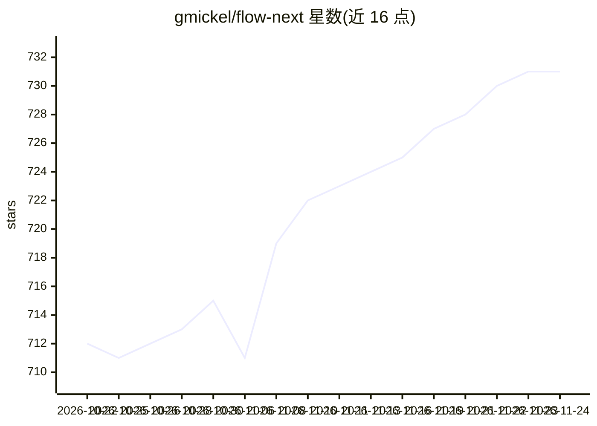

# gmickel/flow-next

⭐ 733 · Python · MIT · 推送 2026-11-22 · [GitHub](https://github.com/gmickel/flow-next) · [官网](https://flow-next.dev) · 个人维护

**给编码 agent 的工作流插件：从 bug/需求到经验证的 PR**

Flow-Next 是运行在编码 agent 之上的工作流插件：接收 bug、想法、工单或性能问题，按任务类型选择路线，先写规格与验收标准再构建变更；当风险较高时由另一模型家族执行交叉评审，并附带现场 QA 与可核验的产出记录。状态与规格存于仓库 `.flow/` 目录，停止使用后仍可读。支持无人值守模式（--auto、--until=merge），可与 Linear、GitHub、GitLab、Jira 等跟踪器桥接。需宿主 agent、Python 3.11+，评审与 PR 步骤另需 jq 和 gh/glab。

## 筛选速览

| 维度 | 判定 | 备注 |
|---|---|---|
| AI 角色 | `ai-ecosystem` | LLM/agent 周边工具 |
| 许可风险 | `permissive` | MIT |
| 部署形态 | `None` |  |
| 模型依赖 | — | README 未给出锁定关系 |
| 硬件要求 | — | 无带数字的原话,不猜 |
| 安装摩擦 | `low` | 无编译、无系统依赖或容器化 |
| 成熟度 | — | 结构信号不足 |

## 能力要点

- 按任务类型选择工作流路线，写规格并映射变更到验收标准
- 跨模型家族评审：写 diff 的模型不评审自己的产出
- 无人值守模式自动修复直到评审通过，并可跟随 CI 合并 PR
- 每个阶段输出 ran/skipped/failed 状态与调用记录

## 适用场景

- 把粘贴的报错堆栈转成失败测试并修复到红转绿
- 从工单或想法自动走到可评审的 PR
- 无人值守让流程跑完规格、评审、合并全链路
- 为监管环境留存开发证据与审批检查点

## 场景标签

`编码 Agent` `代码审查` · 领域:编码与开发

## 证据(README 行号)

> L13: Flow-Next is a workflow plugin for your coding agent. Hand it a bug, an idea, a ticket or a slow page, and it takes
> L30: It runs on Claude Code, OpenAI Codex, Factory Droid, Cursor, xAI Grok Build, OpenCode, Meta Muse Code and Google An

## 星数曲线

2026-10-22 712 → 2026-11-24 731（+19）

---
*卡片 v1 · prompt 1.4 · 生成 2026-11-24 · 置信度 high · 依据 README sha `c5b0ba053617` · [字段定义](../../DATASET.md)*
