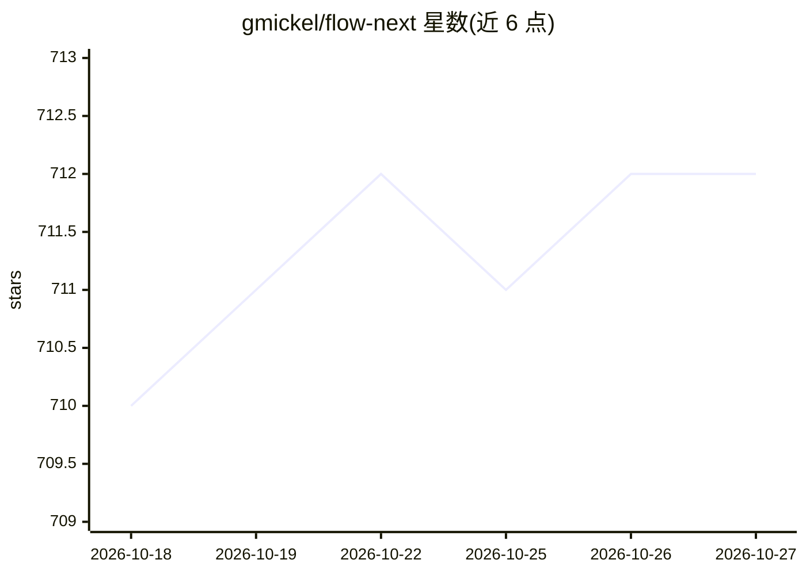

# gmickel/flow-next

⭐ 712 · Python · MIT · 推送 2026-10-25 · [GitHub](https://github.com/gmickel/flow-next) · [官网](https://flow-next.dev) · 个人维护

**编码 agent 的工作流插件：从 bug/想法/工单直达经验证的 PR**

面向编码 agent（Claude Code、Codex、Cursor、Droid、Grok Build、OpenCode、Muse Code）的工作流插件。输入 bug、想法或工单，生成带编号验收标准的 spec，构建变更，高风险时由另一模型家族交叉审查，运行实测验证，最终产出 PR 并将每处变更映射到验收标准。所有阶段输出 ran/skipped/failed 状态，spec、决策与 receipts 存于仓库 .flow/ 目录。支持 --auto 无人值守与 --until=merge 自动合并。需 Python 3.11+，审查与 PR 步骤另用 jq 和 gh。

## 筛选速览

| 维度 | 判定 | 备注 |
|---|---|---|
| AI 角色 | `ai-ecosystem` | LLM/agent 周边工具 |
| 许可风险 | `permissive` | MIT |
| 部署形态 | `None` |  |
| 模型依赖 | locked-api |  |
| 硬件要求 | — | 无带数字的原话,不猜 |
| 安装摩擦 | `low` | 无编译、无系统依赖或容器化 |
| 成熟度 | — | 结构信号不足 |

## 能力要点

- spec→构建→跨模型审查→实测验证→PR 的分阶段工作流
- 写 diff 的模型不审查自己的 diff，按风险触发跨模型家族审查
- 每处变更映射到验收标准，阶段状态可读，receipts 存于 .flow/ 目录
- --auto/--until=merge 无人值守模式，输出 PILOT_VERDICT 最终判定

## 适用场景

- 把 bug 报告或工单交给 agent 修到可审查的 PR
- 为大型功能先生成带验收标准的 spec 再构建
- 无人值守地完成从 spec 到合并的完整流程

## 场景标签

`编码 Agent` `代码审查` `工作流自动化` · 领域:效率与自动化

## 证据(README 行号)

> L13: Flow-Next is a workflow plugin for your coding agent. Hand it a bug, an idea, a ticket or a slow page, and it takes
> L29: It runs on Claude Code, OpenAI Codex, Factory Droid, Cursor, xAI Grok Build, OpenCode and Meta Muse Code.
> L86: 1. Install for your host with the block above, then run `/flow-next:setup` in a project (Codex: `$flow-next-setup`)

## 星数曲线

2026-10-18 710 → 2026-10-27 712（+2）

---
*卡片 v1 · prompt 1.4 · 生成 2026-10-21 · 置信度 high · 依据 README sha `9ad3171230dd` · [字段定义](../../DATASET.md)*
