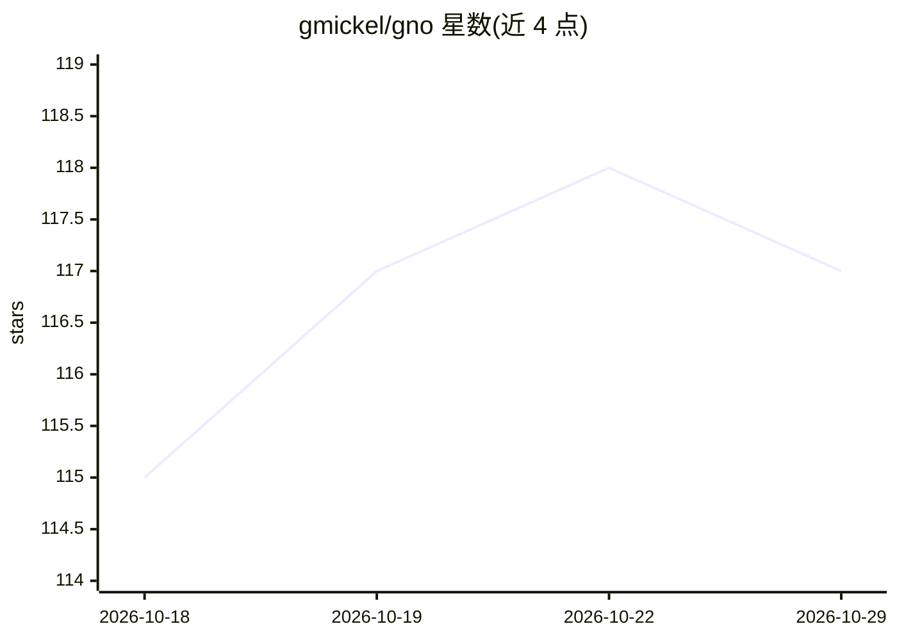

# gmickel/gno

⭐ 117 · TypeScript · MIT · 推送 2026-10-26 · [GitHub](https://github.com/gmickel/gno) · [官网](https://www.gno.sh) · 个人维护

**本地文档知识引擎：混合检索、可验证 LLM 问答与多接口**

面向个人与开发者的本地知识引擎：对 Markdown、PDF、Office 文档、源码及邮件/日历/转录导出建统一索引，提供 BM25、向量与混合三种检索，并在 CLI、Web UI、REST API、TypeScript SDK、MCP 服务器与 headless 守护进程六种接口上共享同一索引。自然语言提问可生成带引用的回答，gno ask --verify 对声明逐条分类并在支持率不足时拒答。通过 MCP 与技能安装接入 Claude、Codex、Cursor 等 AI 客户端；默认嵌入模型为 Qwen3-Embedding-0.6B-GGUF，无需 GPU，MIT 许可。macOS 向量检索需另行安装 Homebrew SQLite。

## 筛选速览

| 维度 | 判定 | 备注 |
|---|---|---|
| AI 角色 | `ai-native` | 本体是模型或模型工具 |
| 许可风险 | `permissive` | MIT |
| 部署形态 | `None` |  |
| 模型依赖 | — | README 未给出锁定关系 |
| 硬件要求 | `cpu-ok` | |
| 安装摩擦 | `low` | 无编译、无系统依赖或容器化 |
| 成熟度 | — | 结构信号不足 |

## 能力要点

- BM25/向量/混合三路检索，融合重排并可解释
- 带引用的 LLM 问答与 --verify 逐声明核验、不足即拒答
- 六种接口共享同一索引，一键接入 Claude/Codex/Cursor 等客户端
- 每集合 local_only/lan/remote 出口策略，零遥测

## 适用场景

- 把散落在 Markdown、代码、PDF、Office 里的笔记做成可检索知识库
- 给编码 agent 接入本地记忆而不上传文档到云 API
- 让 AI 客户端通过 MCP 检索并引用我的文档回答问题
- 事后追溯某条结论依据了哪些原文片段

## 场景标签

`知识库管理` `语义搜索` `文档问答` · 领域:知识与检索

## 证据(README 行号)

> L5: A local knowledge engine for your notes, code, PDFs, and Office docs. Hybrid search, a browsable workspace with grap
> L35: **Answers with citations.** Ask a question in natural language and get an answer built from your own documents, wit

## 星数曲线

2026-10-18 115 → 2026-10-29 117（+2）

---
*卡片 v1 · prompt 1.4 · 生成 2026-10-23 · 置信度 high · 依据 README sha `e3fd522042c4` · [字段定义](../../DATASET.md)*
