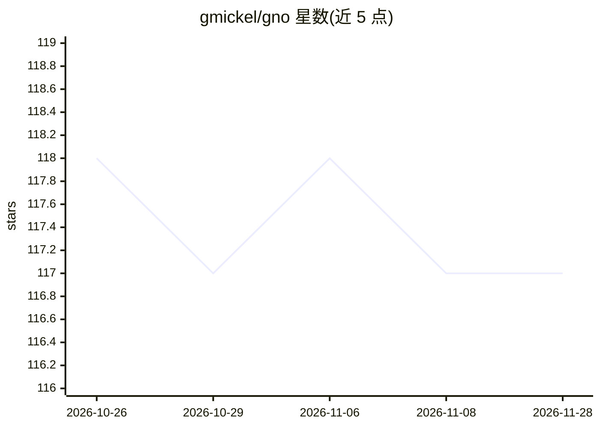

# gmickel/gno

⭐ 117 · TypeScript · MIT · 推送 2026-11-27 · [GitHub](https://github.com/gmickel/gno) · [官网](https://www.gno.sh) · 个人维护

**本地知识引擎：检索个人笔记/代码/PDF 并给出带引用的回答**

面向本地文档（Markdown、PDF、Office、源码、邮件/日历导出）的知识引擎，提供 BM25、向量与混合三种检索，融合重排并可解释；自然语言提问会基于自有文档生成带出处的回答，`gno ask --verify` 可对每条声明做支持度校验并在不足 100% 时拒绝输出。索引通过 CLI、Web UI、REST API、TypeScript SDK、MCP server 与守护进程六种接口共用，可一键接入十个 agent 客户端。完全本地运行，无遥测、无需账户，MIT 许可；Windows 有桌面 beta 包，macOS 向量检索需 Homebrew SQLite。

## 筛选速览

| 维度 | 判定 | 备注 |
|---|---|---|
| AI 角色 | `ai-native` | 本体是模型或模型工具 |
| 许可风险 | `permissive` | MIT |
| 部署形态 | `None` |  |
| 模型依赖 | local-ok | 支持本地模型 |
| 硬件要求 | `cpu-ok` | |
| 安装摩擦 | `low` | 无编译、无系统依赖或容器化 |
| 成熟度 | — | 结构信号不足 |

## 能力要点

- Context Capsules：按目标编译带行号、哈希与 token 预算的证据包（README 称检索调用减少 48.94%）
- `gno ask --verify` 逐条声明校验，支持率不足 100% 时拒答并指出失败声明
- 按集合的 fail-closed 出口策略（local_only/lan/remote）
- 一次索引六种接口：CLI、Web UI、REST、SDK、MCP、守护进程

## 适用场景

- 把分散在笔记、代码、PDF、邮件导出里的知识建成一个本地可检索库
- 让编码 agent 拥有不外传云端的本地记忆与引用规范
- 事后需要证明结论依据的是哪些文件字节
- 通过 MCP 把个人知识库接入 Claude Desktop/Cursor 等 AI 客户端

## 场景标签

`知识库管理` `语义搜索` `文档问答` · 领域:知识与检索

## 证据(README 行号)

> L5: A local knowledge engine for your notes, code, PDFs, and Office docs. Hybrid search, a browsable workspace with grap
> L35: **Answers with citations.** Ask a question in natural language and get an answer built from your own documents, wit
> L37: **Six interfaces on one index.** A fast CLI, a web UI, a REST API, a TypeScript SDK, an MCP server, and a headless 

## 星数曲线

2026-10-26 118 → 2026-11-28 117（-1）

---
*卡片 v1 · prompt 1.4 · 生成 2026-11-28 · 置信度 high · 依据 README sha `50030ee5e4ab` · [字段定义](../../DATASET.md)*
