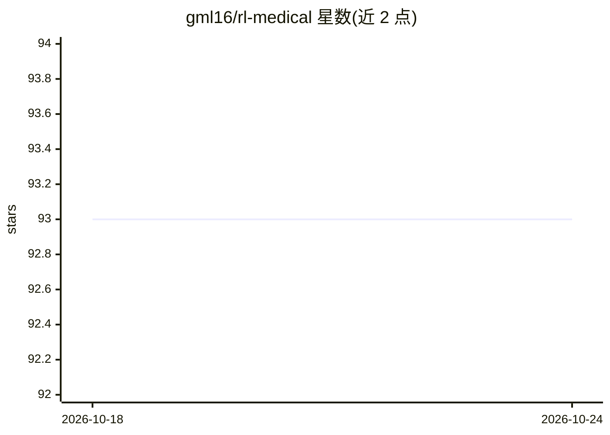

# gml16/rl-medical

⭐ 93 · Python · Apache-2.0 · 推送 2026-05-01 · [GitHub](https://github.com/gml16/rl-medical) · [官网](https://arxiv.org/abs/2008.08055) · 个人维护

**面向3D医学图像解剖标志点检测的多智能体深度强化学习代码库**

论文 Communicative Reinforcement Learning Agents for Landmark Detection in Brain Images 的 PyTorch 实现库：实现 C-MARL 通信式多智能体强化学习系统，在3D医学图像（脑MRI、胎儿超声、心脏MRI）中自动检测解剖标志点，智能体通过显式通信通道与共享架构权重协作；另支持单智能体与无通信多智能体（Network3d）。提供 Conda 环境文件、训练/评估/无真值推理三种模式及可视化脚本，data 文件夹内置 10 例带 20 个标志点标注的 ADNI 脑 MRI。代码由 Amir Alansary 仓库 fork 而来。

## 筛选速览

| 维度 | 判定 | 备注 |
|---|---|---|
| AI 角色 | `ai-native` | 本体是模型或模型工具 |
| 许可风险 | `permissive` | Apache-2.0 |
| 部署形态 | `None` |  |
| 模型依赖 | — | README 未给出锁定关系 |
| 硬件要求 | — | 无带数字的原话,不猜 |
| 安装摩擦 | `medium` | 含编译或系统依赖之一 |
| 成熟度 | — | 结构信号不足 |

## 能力要点

- C-MARL 多智能体通过显式通信与权重共享协作检测标志点
- 支持单智能体与无通信多智能体（Network3d）模式
- 内置 10 例 ADNI 脑 MRI 数据（各含 20 个标志点标注）
- 提供 train/eval/play 三种任务模式与标志点可视化脚本

## 适用场景

- 复现论文中的脑MRI标志点检测实验
- 在自有3D医学影像上训练/评估标志点检测智能体
- 在无真值标注的影像上运行推理检测标志点

## 场景标签

`强化学习` `目标检测` · 领域:感知与多模态

## 证据(README 行号)

> L3: Multiagent Deep Reinforcement Learning for Anatomical Landmark Detection using PyTorch.
> L8: Accurate detection of anatomical landmarks is an essential step in several medical imaging tasks. This repository im

## 星数曲线

2026-10-18 93 → 2026-10-24 93（+0）

---
*卡片 v1 · prompt 1.4 · 生成 2026-10-23 · 置信度 high · 依据 README sha `c46a047cef80` · [字段定义](../../DATASET.md)*
