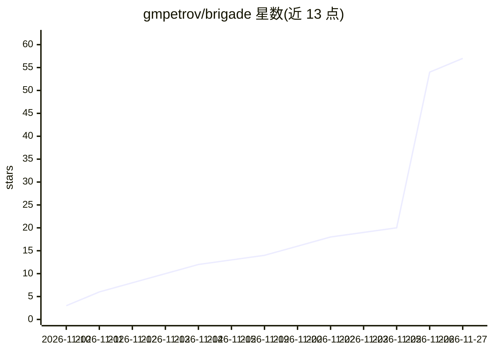

# gmpetrov/brigade

⭐ 57 · TypeScript · MIT · 推送 2026-11-26 · [GitHub](https://github.com/gmpetrov/brigade) · [官网](https://www.brigade.lol) · 个人维护

**自托管 AI 队友平台：复用 Claude/ChatGPT 订阅跑公司任务**

开源自托管的 AI 团队协调平台（MIT）：每个"队友"即一个以用户本人账号登录的 Claude Code 或 Codex CLI 实例，配独立云端/本地计算机、App 权限、记忆与技能。支持多账号额度接力、触发器与定时任务、写操作审批队列、手机端推送、操作全量日志与每日用量上限。本地运行需 Node.js 24、pnpm 与 Docker；免费版跑在自己电脑上，另提供按工作区订阅的 Brigade Cloud。

## 筛选速览

| 维度 | 判定 | 备注 |
|---|---|---|
| AI 角色 | `ai-ecosystem` | LLM/agent 周边工具 |
| 许可风险 | `permissive` | MIT |
| 部署形态 | `self-host` | docker 或自建部署 |
| 模型依赖 | locked-api |  |
| 硬件要求 | — | 无带数字的原话,不猜 |
| 安装摩擦 | `low` | 无编译、无系统依赖或容器化 |
| 成熟度 | — | 结构信号不足 |

## 能力要点

- 队友即官方 Claude Code/Codex CLI，用用户自有订阅运行，不产生额外 AI 计费
- 多账号额度接力：同供应商账号用尽自动切换
- 触发器/定时任务自动启动线程，写操作可设为等待人工批准
- 凭据存于 vault，队友不接触密码；每步操作记录为事件可回放

## 适用场景

- 同时管理多个 Claude Code/Codex 会话并追踪各自状态
- 让 AI 队友自动处理客服邮件、营销与销售跟进
- 笔记本关机后让任务在云端计算机继续运行
- 需要审批机制控制 AI 对 Stripe/邮件等的写操作

## 场景标签

`多智能体` `编码 Agent` `AI 助手` · 领域:Agent 开发

## 证据(README 行号)

> L24: Each teammate is the real **Claude Code** or **Codex**, signed in with your own account, with a job, its own
> L170: - **The runner** links a computer to the workspace and runs each thread with the real Claude Code or Codex CLI,
> L179: Brigade is open source under the MIT license. The whole product is in this repository: we don't gate features.

## 星数曲线

2026-11-10 3 → 2026-11-27 57（+54）

---
*卡片 v1 · prompt 1.4 · 生成 2026-11-18 · 置信度 mid · 依据 README sha `6d8ddf9a5291` · [字段定义](../../DATASET.md)*
