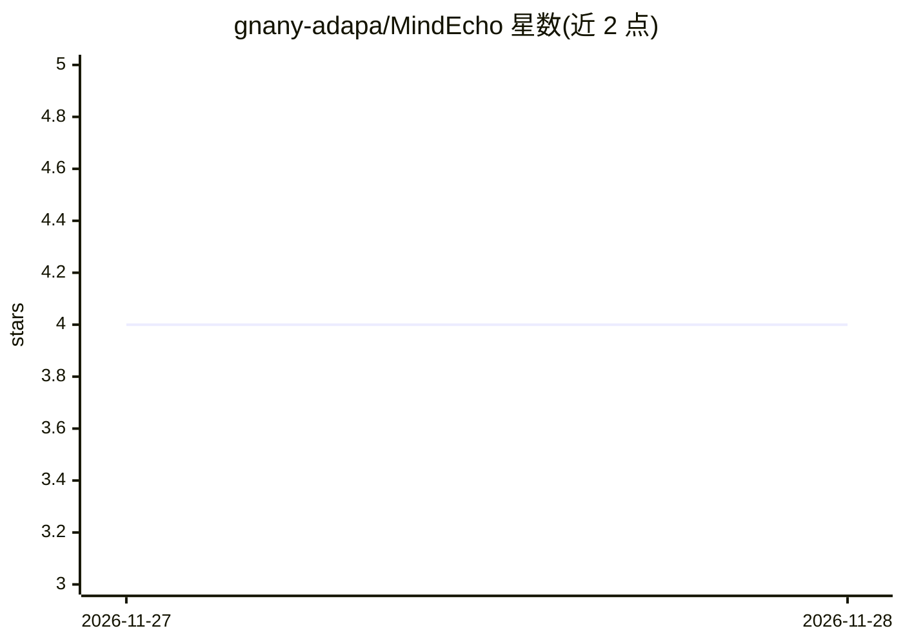

# gnany-adapa/MindEcho

⭐ 4 · Python · MIT · 推送 2026-11-26 · [GitHub](https://github.com/gnany-adapa/MindEcho) · 个人维护

**可溯源审计的 AI 人格问答引擎：区分真实引文与推理外推**

FastAPI + Streamlit 构建的人格问答引擎：摄入用户自有语料（演讲、文章、文档），经离线管道（map→consolidate→compress）蒸馏出带验证引文支撑的 principles.json 原则集。回答时逐条校验引文确实出现在源文本中，捏造或转述引文被丢弃；语料未覆盖的问题经 factor→principle→inference 追踪生成并标注为外推假设，内置 faithfulness critic 检查与评测工具，可选 Langfuse 追踪。通过 LLMProvider 接口切换 OpenAI/Anthropic/本地模型/代理，自带 Streamlit 演示界面。

## 筛选速览

| 维度 | 判定 | 备注 |
|---|---|---|
| AI 角色 | `ai-native` | 本体是模型或模型工具 |
| 许可风险 | `permissive` | MIT |
| 部署形态 | `library` | 以包/库形式分发 |
| 模型依赖 | — | README 未给出锁定关系 |
| 硬件要求 | — | 无带数字的原话,不猜 |
| 安装摩擦 | `low` | 无编译、无系统依赖或容器化 |
| 成熟度 | — | 结构信号不足 |

## 能力要点

- 引文逐条校验：仅展示在源文本中逐字出现的引文
- 原则蒸馏管道产出可检视的 principles.json
- 外推回答带前提→原则→结论追踪并明确标注
- LLMProvider 统一接口，环境变量切换供应商

## 适用场景

- 基于某人演讲/文集构建带出处的问答人格
- 需要区分真实引文与模型推论的对话系统
- 对回答来源做审计与忠实度检查

## 场景标签

`聊天机器人` `RAG` `模型评测` · 领域:对话与助手

## 证据(README 行号)

> L3: **An open-source engine for *grounded, auditable* AI personas — it answers *as* a person
> L15: - **Verified grounding, not vibes.** When the persona answers from the corpus, each cited
> L42: Streamlit UI ──HTTP──▶ FastAPI backend

## 星数曲线

2026-11-27 4 → 2026-11-28 4（+0）

---
*卡片 v1 · prompt 1.4 · 生成 2026-11-27 · 置信度 high · 依据 README sha `8954d4cb4237` · [字段定义](../../DATASET.md)*
