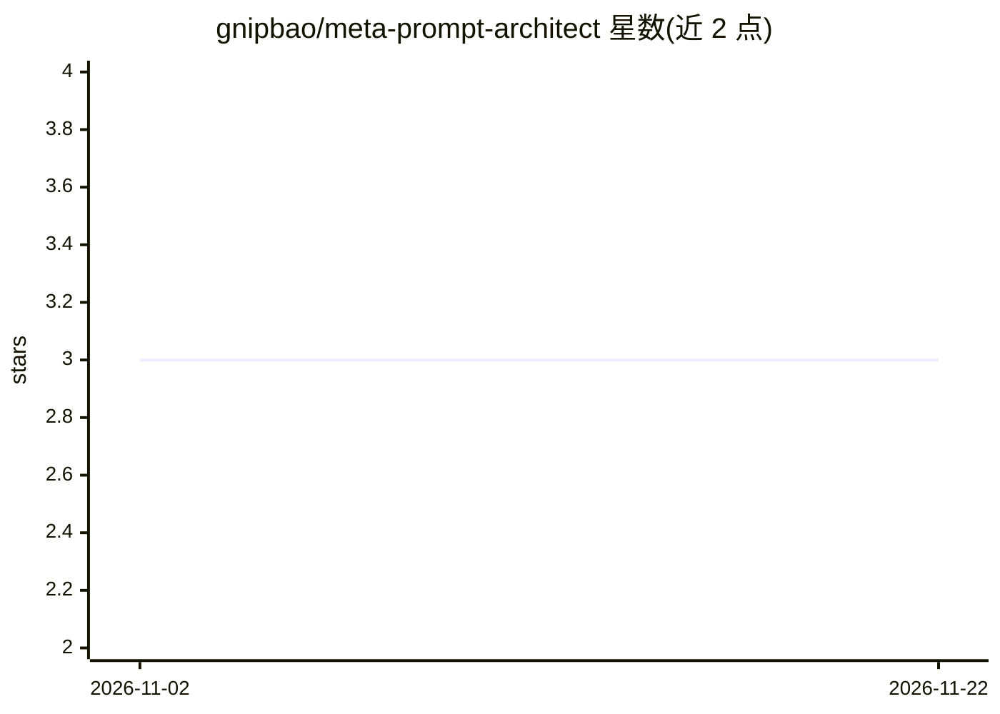

# gnipbao/meta-prompt-architect

⭐ 3 · MIT · 推送 2026-10-15 · [GitHub](https://github.com/gnipbao/meta-prompt-architect) · 个人维护 · 中文 README

**面向 Agent 用户的提示词创建、诊断与审计技能**

以 Codex Skill 形式分发的元提示词工程技能：提供三种工作模式——按需求与约束新建结构化提示词、对旧提示词逐段诊断并改写且保留修改对照、对失败输出定位根因并给出最小修复与回归用例，另支持只读审计模式仅定位问题不改写。工作流按复杂度读取蓝图与审核量表，缺失信息达到条件时先澄清；质量检查包含六项硬门与五维加权评分。通过 git clone 安装到 Codex skills 目录，需完整保留 references 与 examples 目录；README 声明尚未在目标模型上执行行为回放。

## 筛选速览

| 维度 | 判定 | 备注 |
|---|---|---|
| AI 角色 | `ai-knowledge` | 知识聚合/清单类 |
| 许可风险 | `permissive` | MIT |
| 部署形态 | `None` |  |
| 模型依赖 | — | README 未给出锁定关系 |
| 硬件要求 | — | 无带数字的原话,不猜 |
| 安装摩擦 | `low` | 无编译、无系统依赖或容器化 |
| 成熟度 | `idea` | |

## 能力要点

- 三种模式：新建、优化（含诊断与修改对照）、失败输出根因修复
- 只读审计模式：仅定位问题与评分，不输出替代提示词
- 六项硬门与五维加权评分的质量检查机制
- 回归用例覆盖原失败与原成功行为

## 适用场景

- 从想法出发写出可复制的结构化提示词
- 优化已有提示词并保留逐段修改对照
- 诊断会编造数据或格式漂移的失败提示词
- 只审计 system prompt 而不重写

## 场景标签

`提示工程` · 领域:Agent 开发

## 证据(README 行号)

> L5: An agent skill for creating, diagnosing, and improving prompts with explicit variables, evidence boundaries, output 
> L17: |模式|输入|主要交付|
> L31: ```bash

## 星数曲线



2026-11-02 3 → 2026-11-22 3（+0）


---
*卡片 v1 · prompt 1.4 · 生成 2026-11-22 · 置信度 high · 依据 README sha `8e302c4c75ed` · [字段定义](../../DATASET.md)*
