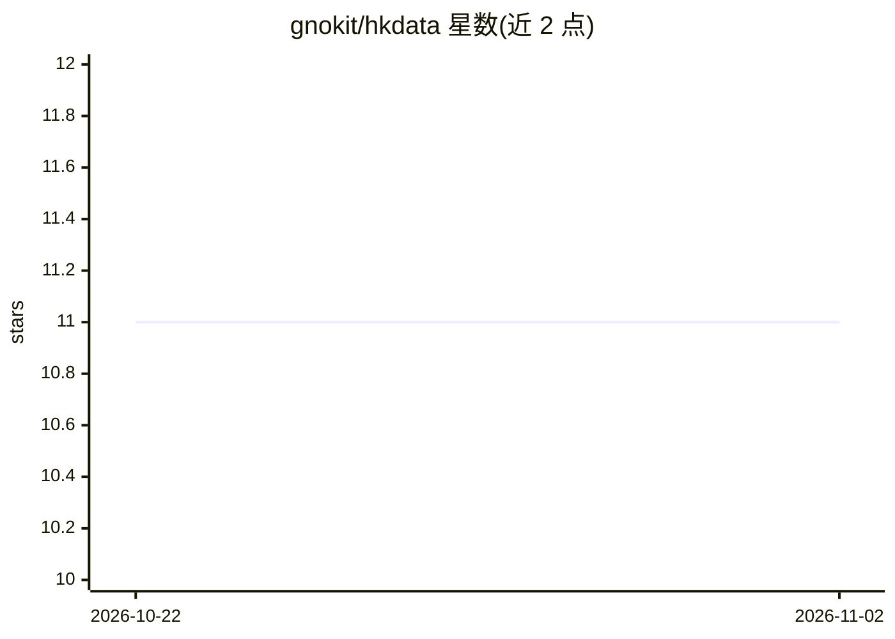

# gnokit/hkdata

⭐ 11 · Python · MIT · 推送 2026-10-20 · [GitHub](https://github.com/gnokit/hkdata) · 组织维护 · 中文 README

**香港开放数据查询技能：让 AI Agent 带来源地查询 data.gov.hk**

面向编码型 AI Agent 的 SKILL.md 技能包：将 data.gov.hk 全部约 3,822 个数据集爬取为本地去 PII 目录，用 ChromaDB 混合检索（多语种稠密向量+关键词）支持英文与繁体中文查询；对新问题走探索→测试→写函数→reindex 流程，已验证配方保存为可运行函数供下次一步命中。回答引用数据集 ID、endpoint 与数据自带 HKT 时间戳，无匹配数据集时明确告知。默认用本地 Ollama 嵌入，可切换 OpenAI 兼容 API。范围仅限香港政府数据。

## 筛选速览

| 维度 | 判定 | 备注 |
|---|---|---|
| AI 角色 | `ai-ecosystem` | LLM/agent 周边工具 |
| 许可风险 | `permissive` | MIT |
| 部署形态 | `library` | 以包/库形式分发 |
| 模型依赖 | local-ok | 支持本地模型 |
| 硬件要求 | — | 无带数字的原话,不猜 |
| 安装摩擦 | `low` | 无编译、无系统依赖或容器化 |
| 成熟度 | — | 结构信号不足 |

## 能力要点

- 覆盖 data.gov.hk 约 3,822 个数据集的双语（英/繁中）离线目录
- ChromaDB 混合检索：稠密向量+关键词+机构别名归一
- 自扩展机制：新问题的解法写成可运行函数并重新索引
- 回答强制引用数据集 ID、endpoint 与 HKT 时间戳，无数据时如实说明

## 适用场景

- 让 AI Agent 用粤语/中文查询香港政府实时数据（车位、空气、课程等）
- Agent 重复回答同类香港数据问题时直接复用已索引函数
- 在香港政府数据范围内做有出处的问答，避免无据回答

## 场景标签

`RAG` · 领域:知识与检索

## 证据(README 行号)

> L3: **香港政府開放數據 × AI Agent 技能** — a self-extending query toolkit for
> L160: SKILL.md                  the coding-agent workflow (the agent entrypoint)

## 星数曲线

2026-10-22 11 → 2026-11-02 11（+0）

---
*卡片 v1 · prompt 1.4 · 生成 2026-11-02 · 置信度 high · 依据 README sha `2f508783cc3c` · [字段定义](../../DATASET.md)*
