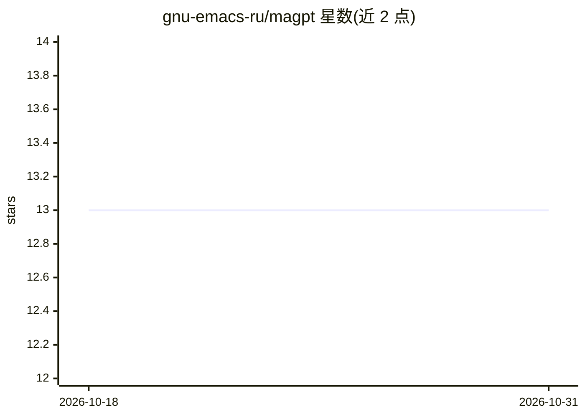

# gnu-emacs-ru/magpt

⭐ 13 · Emacs Lisp · MIT · 推送 2026-04-06 · [GitHub](https://github.com/gnu-emacs-ru/magpt) · [官网](https://github.com/11111000000/magpt) · 个人维护

**Emacs 中的安全优先 AI Git 助手，面向 Magit 用户**

单文件 Emacs Lisp 包（需 Emacs 28.1+ 与 gptel 0.9+），通过 gptel 以供应商无关方式接入 LLM，为 Git/Magit 工作流提供 AI 辅助：从暂存 diff 生成 Conventional Commits 风格提交信息、解释仓库状态、建议分支名、按意图分组暂存、PR 摘要与冲突解决草案。机制上采用预览优先与可逆操作，发送前显示内容与字节大小，Apply 受开关与确认门控，支持经 gptel 配置 Ollama 实现纯本地调用；Magit/transient 为可选依赖。

## 筛选速览

| 维度 | 判定 | 备注 |
|---|---|---|
| AI 角色 | `ai-native` | 本体是模型或模型工具 |
| 许可风险 | `permissive` | MIT |
| 部署形态 | `None` |  |
| 模型依赖 | local-ok | 支持本地模型 |
| 硬件要求 | — | 无带数字的原话,不猜 |
| 安装摩擦 | `low` | 无编译、无系统依赖或容器化 |
| 成熟度 | — | 结构信号不足 |

## 能力要点

- 从暂存 diff 生成提交信息、状态解释、分支名建议、按意图暂存等任务管线
- 预览优先：发送前展示将发送内容与字节大小，Apply 仅限可逆操作并需确认
- 供应商无关，经 gptel 支持 OpenAI/Anthropic/本地 Ollama 后端
- Magit Status 集成 AI 概览与快捷键，提供学习模式（禁用 Apply 与插入）

## 适用场景

- 在 Magit 提交缓冲区里从暂存 diff 生成提交信息
- 让我在复杂仓库状态下看到风险说明与可复制的下一步 Git 命令/Magit 按键
- 用本地 Ollama 后端做零外部请求的 Git 辅助
- 学习 Git 时以只读预览模式查看建议而不执行任何变更

## 场景标签

 · 领域:开发者工具/编辑器 AI 助手

## 证据(README 行号)

> L21: - Commit messages (Conventional Commits): Draft a clear, concise message from your staged diff. Insertion is opt‑in
> L25: - Read‑only assist tasks: Explain current status, lint an existing commit message, suggest a branch name, explain a

## 星数曲线

2026-10-18 13 → 2026-10-31 13（+0）

---
*卡片 v1 · prompt 1.4 · 生成 2026-10-31 · 置信度 high · 依据 README sha `55b20e97f81c` · [字段定义](../../DATASET.md)*
