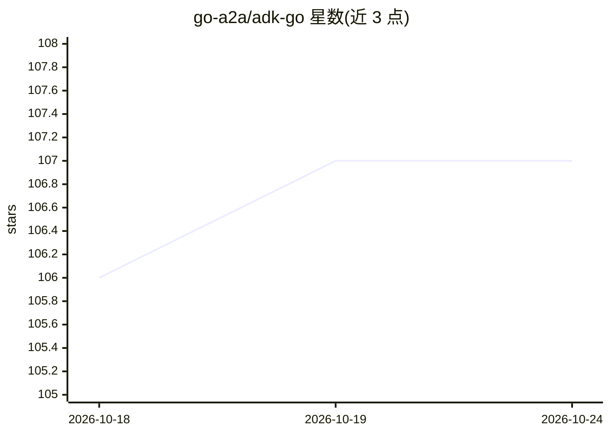

# go-a2a/adk-go

⭐ 107 · Go · Apache-2.0 · 推送 2025-10-31 · [GitHub](https://github.com/go-a2a/adk-go) · [官网](http://pkg.go.dev/github.com/go-a2a/adk-go) · 组织维护

**Go 语言 AI Agent 开发工具包：构建/评估/部署智能体**

开源、代码优先的 Go 工具包，用于构建、评估和部署 AI agent。仿照 Python 版 adk-python 实现，提供 LLM、Sequential、Parallel、Loop 四类 agent 的分层组合架构，经 google.golang.org/genai 统一接口接入 Google Gemini 与 Anthropic Claude 等模型。功能含自动函数调用工具系统、向量检索的长期记忆、三层会话状态管理、多后端代码执行、Go 1.23+ 迭代器流式事件。项目处于 alpha 阶段，接口与行为可能变化。

## 筛选速览

| 维度 | 判定 | 备注 |
|---|---|---|
| AI 角色 | `ai-ecosystem` | LLM/agent 周边工具 |
| 许可风险 | `permissive` | Apache-2.0 |
| 部署形态 | `None` |  |
| 模型依赖 | locked-api |  |
| 硬件要求 | — | 无带数字的原话,不猜 |
| 安装摩擦 | `low` | 无编译、无系统依赖或容器化 |
| 成熟度 | `idea` | |

## 能力要点

- LLM/Sequential/Parallel/Loop 四类 agent 分层组合
- 多模型提供方统一接口（Gemini、Claude 等）
- 自动函数调用工具系统与多方案认证（OAuth2/API Key 等）
- 基于 Go 1.23+ 迭代器的实时流式事件

## 适用场景

- 用 Go 构建多 agent 分层系统
- 为 agent 接入 Gemini/Claude 等模型并挂载工具
- 需要类型安全与并发的 agent 服务开发

## 场景标签

`Agent 框架` `多智能体` · 领域:Agent 开发

## 证据(README 行号)

> L3: An open-source, code-first Go toolkit for building, evaluating, and deploying sophisticated AI agents with flexibili
> L22: - **🤖 Multi-Agent Architecture**: Build hierarchical agent systems with LLM, Sequential, Parallel, and Loop agents
> L255: This is a Go implementation of the Agent Development Kit (ADK), a toolkit for building, evaluating, and deploying 

## 星数曲线

2026-10-18 106 → 2026-10-24 107（+1）

---
*卡片 v1 · prompt 1.4 · 生成 2026-10-23 · 置信度 high · 依据 README sha `46385ef6b7f2` · [字段定义](../../DATASET.md)*
