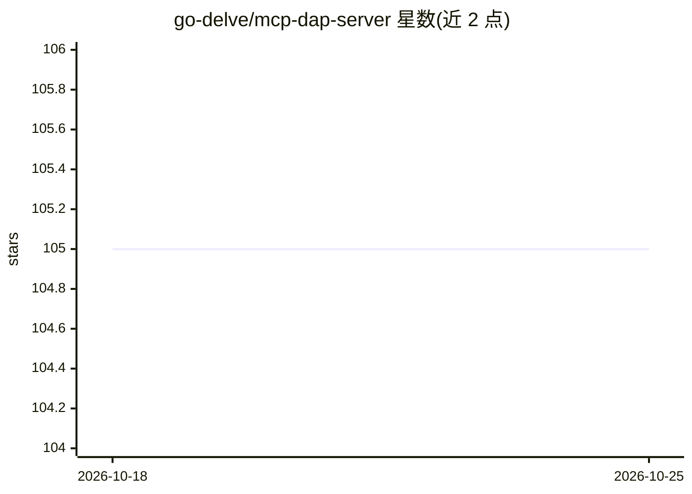

# go-delve/mcp-dap-server

⭐ 105 · Go · MIT · 推送 2026-09-23 · [GitHub](https://github.com/go-delve/mcp-dap-server) · 组织维护

**让 AI Agent 通过 DAP 调试器调试运行中程序的 MCP 服务器**

作为 MCP 客户端与 DAP 兼容调试器之间的桥接服务器，使 AI 助手能够以编程方式控制调试会话。提供 13 个工具，覆盖会话管理（debug/stop/restart，支持源码、二进制、core dump 与 attach 四种模式）、断点管理、执行控制（continue/step/pause）、状态检查（栈帧、变量、表达式求值、反汇编）。通过 stdio 传输运行，需 Go 1.24.4 及以上自行编译构建，并要求目标语言有 DAP 兼容调试器。安全上仅建议在受信任的单用户环境以最小权限账户运行。

## 筛选速览

| 维度 | 判定 | 备注 |
|---|---|---|
| AI 角色 | `ai-ecosystem` | LLM/agent 周边工具 |
| 许可风险 | `permissive` | MIT |
| 部署形态 | `None` |  |
| 模型依赖 | — | README 未给出锁定关系 |
| 硬件要求 | — | 无带数字的原话,不猜 |
| 安装摩擦 | `low` | 无编译、无系统依赖或容器化 |
| 成熟度 | — | 结构信号不足 |

## 能力要点

- 单一 debug 工具统一处理 source/binary/core/attach 四种调试模式
- 13 个工具覆盖会话、断点、执行控制、状态检查与反汇编
- stdio 传输，AI agent 可按需拉起
- 执行控制类工具返回完整上下文（位置、栈、变量）

## 适用场景

- 让 AI 编程助手在调试会话中设置断点、单步执行并检查变量
- Agent 自主调试运行中的程序或 core dump 文件
- 在 MCP 客户端（如 Claude Code）中以统一协议操控多种语言的调试器

## 场景标签

 · 领域:开发者工具/AI Agent 基础设施

## 证据(README 行号)

> L3: A Model Context Protocol (MCP) server that provides debugging capabilities through the Debug Adapter Protocol (DAP).
> L7: The MCP DAP Server acts as a bridge between MCP clients and DAP-compatible debuggers, allowing programmatic control 
> L27: - **Streamlined API**: 13 tools cover all debugging operations

## 星数曲线

2026-10-18 105 → 2026-10-25 105（+0）

---
*卡片 v1 · prompt 1.4 · 生成 2026-10-23 · 置信度 high · 依据 README sha `08afb309da01` · [字段定义](../../DATASET.md)*
