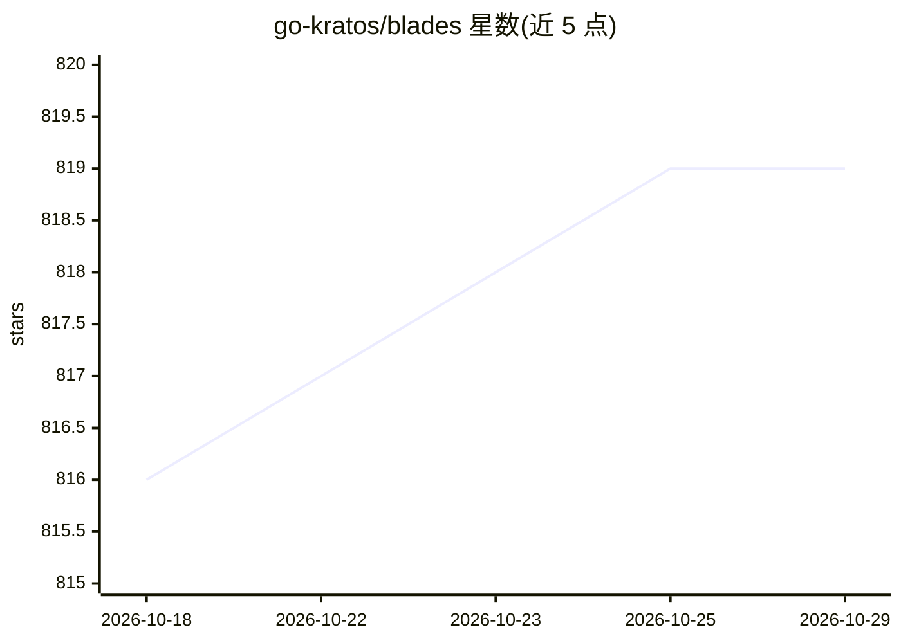

# go-kratos/blades

⭐ 819 · Go · MIT · 推送 2026-08-14 · [GitHub](https://github.com/go-kratos/blades) · [官网](https://go-kratos.dev/blades/) · 组织维护 · 中文 README

**Go 语言多模态 AI Agent 框架：构建可组合的智能体**

Blades 是用 Go 编写的多模态 AI Agent 框架，核心组件包括 Agent、Prompt、Chain、ModelProvider、Tool、Memory 与 Middleware，通过统一接口与可插拔组件实现解耦与扩展。ModelProvider 适配 OpenAI、DeepSeek、Gemini 等模型服务，支持流式生成；Chain/Flow 用于编排多 Agent 工作流与多步推理；Memory 提供会话上下文存储（默认 InMemory 实现）；Middleware 以洋葱模型实现日志、监控、限流等横切控制。另支持通过目录或 embed.FS 注入 Agent 技能。项目自述处于早期阶段，MIT 许可。

## 筛选速览

| 维度 | 判定 | 备注 |
|---|---|---|
| AI 角色 | `ai-ecosystem` | LLM/agent 周边工具 |
| 许可风险 | `permissive` | MIT |
| 部署形态 | `None` |  |
| 模型依赖 | — | README 未给出锁定关系 |
| 硬件要求 | — | 无带数字的原话,不猜 |
| 安装摩擦 | `low` | 无编译、无系统依赖或容器化 |
| 成熟度 | `idea` | |

## 能力要点

- 统一 Agent 接口，Agent/Chain/ModelProvider 均可组合
- 可插拔 ModelProvider 适配 OpenAI/DeepSeek/Gemini 等 LLM
- Flow 编排多 Agent 工作流与多步推理
- Middleware 洋葱模型支持日志、监控、限流等横切能力

## 适用场景

- Go 开发者构建多轮对话与结构化输出应用
- 编排多 Agent 协作的复杂工作流
- 为 Agent 挂载外部工具调用与短期/长期记忆

## 场景标签

`Agent 框架` `多智能体` · 领域:Agent 开发

## 证据(README 行号)

> L7: Blades is a multimodal AI Agent framework for the Go language, supporting custom models, tools, memory, middleware, 

## 星数曲线

2026-10-18 816 → 2026-10-29 819（+3）

---
*卡片 v1 · prompt 1.4 · 生成 2026-10-21 · 置信度 high · 依据 README sha `a6f50234f91d` · [字段定义](../../DATASET.md)*
