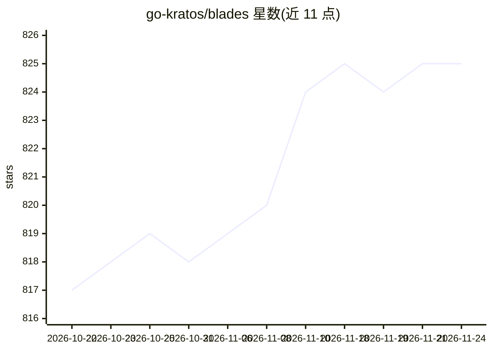

# go-kratos/blades

⭐ 825 · Go · MIT · 推送 2026-11-17 · [GitHub](https://github.com/go-kratos/blades) · [官网](https://go-kratos.dev/blades/) · 组织维护

**Go 语言事件驱动的多模态 AI Agent 框架**

面向 Go 开发者的 LLM Agent 框架：以小接口（Name/Description/Run）定义 Agent，通过事件通道处理流式输入输出；核心模块与 provider SDK 解耦，OpenAI/Anthropic/Gemini/MCP/OpenTelemetry 等适配放在 contrib 独立 Go module 中按需引入。内置工具执行与策略过滤、会话历史、prompt 构建、上下文压缩、生命周期 hook，以及 sequential/parallel/loop/routing/deep 等多 Agent 组合原语；Skills 机制按 SKILL.md 目录按需加载指令。安装方式为 go get。

## 筛选速览

| 维度 | 判定 | 备注 |
|---|---|---|
| AI 角色 | `ai-ecosystem` | LLM/agent 周边工具 |
| 许可风险 | `permissive` | MIT |
| 部署形态 | `None` |  |
| 模型依赖 | — | README 未给出锁定关系 |
| 硬件要求 | — | 无带数字的原话,不猜 |
| 安装摩擦 | `low` | 无编译、无系统依赖或容器化 |
| 成熟度 | — | 结构信号不足 |

## 能力要点

- 事件驱动 Agent 循环：Input/Output 事件流含流式文本、工具生命周期与用量统计
- provider 无关核心，OpenAI/Anthropic/Gemini/MCP 适配以独立 contrib module 提供
- 多 Agent 组合原语（sequential/parallel/loop/routing/deep）及 Agent 即工具封装
- SKILL.md 格式的 Skills 按需加载，含策略与授权边界控制

## 适用场景

- 在 Go 服务中以普通组件形式集成 LLM Agent
- 构建带工具调用与策略控制的多 Agent 流程
- 需要流式输出与中途转向/中止的交互式 Agent 应用

## 场景标签

`Agent 框架` `多智能体` · 领域:Agent 开发

## 证据(README 行号)

> L10: Blades is an event-driven multimodal Agent framework for Go. It provides a small public Agent interface, a provider
> L12: The framework is designed for applications that need LLM agents as normal Go components: explicit inputs and output

## 星数曲线

2026-10-22 817 → 2026-11-24 825（+8）

---
*卡片 v1 · prompt 1.4 · 生成 2026-11-24 · 置信度 high · 依据 README sha `5c27c7a54f46` · [字段定义](../../DATASET.md)*
