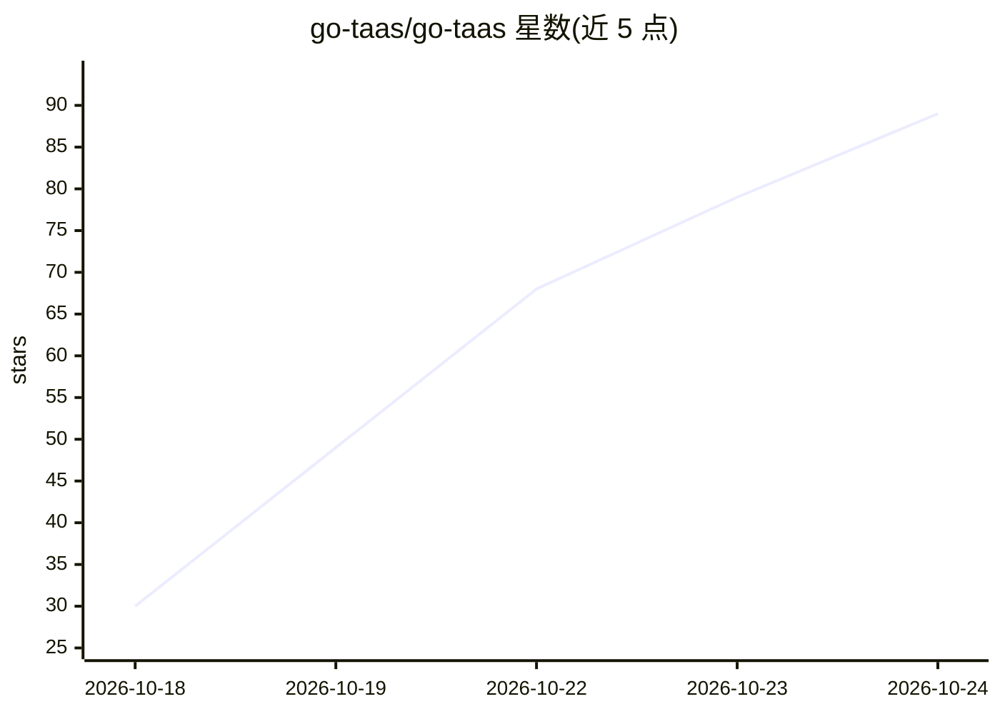

# go-taas/go-taas

⭐ 96 · Go · Apache-2.0 · 推送 2026-10-24 · [GitHub](https://github.com/go-taas/go-taas) · [官网](https://go-taas.com) · 组织维护 · 中文 README

**Kubernetes 上的开源 LLM 推理与计量计费平台（Token as a Service）**

面向企业级 LLM 服务的平台：管理员在异构加速器集群上部署开源模型（Qwen/DeepSeek/LLaMA 等），按模型×卡型定价；Agent 与 SDK 通过 OpenAI 兼容 API 消费，平台在 Envoy+Wasm 网关做 API Key 鉴权、token 计量与结算。功能覆盖模型目录与一键部署、HAMI vGPU 切片、智能路由、自动扩缩容、多租户 RBAC、配额、SSO、计费发票、成本优化与可观测性。后端为 Go 微服务（单 Deployment 24 个微服务），依赖 PostgreSQL/Redis/Kafka/RabbitMQ/Longhorn/MinIO 等组件，架构较重。

## 筛选速览

| 维度 | 判定 | 备注 |
|---|---|---|
| AI 角色 | `ai-ecosystem` | LLM/agent 周边工具 |
| 许可风险 | `permissive` | Apache-2.0 |
| 部署形态 | `self-host` | docker 或自建部署 |
| 模型依赖 | locked-api |  |
| 硬件要求 | — | 无带数字的原话,不猜 |
| 安装摩擦 | `low` | 无编译、无系统依赖或容器化 |
| 成熟度 | — | 结构信号不足 |

## 能力要点

- OpenAI 兼容 API，鉴权/计量/路由在 Envoy+Wasm 网关插件完成
- 模型×卡型价格矩阵、预付费/后付费模式与计费账本
- HAMI vGPU 切片池与 AIBrix 分布式推理运行时支持
- 多租户隔离、配额管理、SSO 联邦与审计日志

## 适用场景

- 在 Kubernetes 集群上部署并对外提供多模型推理服务
- 按 token 用量对内部或外部租户计量计费
- 管理异构 GPU 集群上的多模型路由与弹性伸缩

## 场景标签

`推理引擎` `模型网关` · 领域:Agent 开发

## 证据(README 行号)

> L3: **Token as a Service — an open-source LLM inference and metering/billing platform for AI agents and applications, bu
> L10: **Go TaaS** is an open-source platform for serving and billing large language models on Kubernetes. Administrators 
> L40: |OpenAI-compatible API|`/v1/chat/completions`, `/v1/completions`, and `/v1/embeddings` served by an Envoy-based gat

## 星数曲线

2026-10-18 30 → 2026-10-24 89（+59）

---
*卡片 v1 · prompt 1.4 · 生成 2026-10-23 · 置信度 high · 依据 README sha `1827bdf008c2` · [字段定义](../../DATASET.md)*
