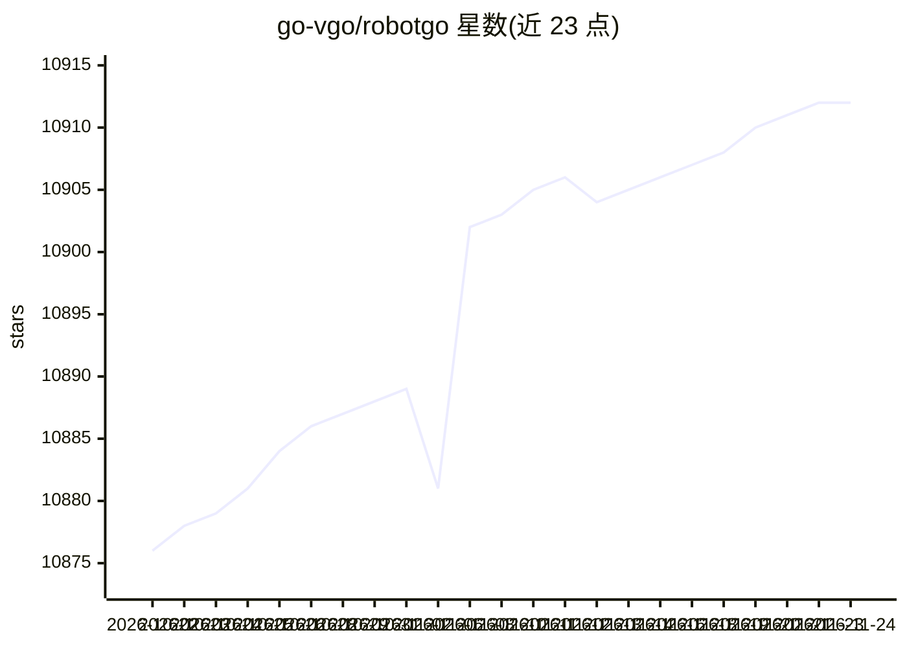

# go-vgo/robotgo

⭐ 10,912 · Go · Apache-2.0 · 推送 2026-11-20 · [GitHub](https://github.com/go-vgo/robotgo) · [官网](https://atomai.cc) · 个人维护 · 中文 README

**Go 跨平台桌面自动化库：控制鼠标键盘、读屏、图像与窗口**

RobotGo 是 Golang 桌面自动化库，提供鼠标键盘控制、屏幕读取、位图与 OpenCV 图像处理、窗口句柄管理和全局事件监听，面向 RPA、自动化测试与 Computer Use 场景。支持 Mac/Windows/Linux 及 arm64/x86-amd64，提供默认 Cgo 与纯 Go（build tag 选择 win/mac/x11/wayland/libei 后端）两种构建路径，各平台有特定权限与依赖要求。作者另维护 AI agent 系统项目 Codg，并有闭源的 RobotGo-Pro 商业版本。

## 筛选速览

| 维度 | 判定 | 备注 |
|---|---|---|
| AI 角色 | `ai-enhanced` | 去掉 AI 部分产品仍成立 |
| 许可风险 | `permissive` | Apache-2.0 |
| 部署形态 | `None` |  |
| 模型依赖 | — | README 未给出锁定关系 |
| 硬件要求 | — | 无带数字的原话,不猜 |
| 安装摩擦 | `medium` | 含编译或系统依赖之一 |
| 成熟度 | — | 结构信号不足 |

## 能力要点

- 鼠标、键盘、屏幕读取、窗口管理、全局事件监听能力
- Cgo 与纯 Go 双构建路径，纯 Go 支持 CGO_ENABLED=0 交叉编译
- 内置 Bitmap 与 OpenCV 图像处理模块
- 支持 ADB 绑定，兼容打包 android adb 与 ios wda

## 适用场景

- 编写跨平台桌面 RPA 自动化脚本
- GUI 自动化测试中模拟输入与校验屏幕内容
- 为 AI agent 提供 Computer Use 类底层操作能力
- 结合 OpenCV 模块做屏幕图像定位

## 场景标签

`GUI 自动化` `图像视频处理` · 领域:效率与自动化

## 证据(README 行号)

> L15: > Golang Desktop Automation, auto test and AI Computer Use.
> L16: > Control the mouse, keyboard, read the screen, process, Window Handle, image and bitmap and global event listener.
> L137: **Tested pure-Go backends** build and cross-compile with `CGO_ENABLED=0`
> L27: RobotGo-Pro get the JavaScript, Python, Lua and others version, tech supports, new features and newest robotgo vers

## 星数曲线

2026-10-22 10,876 → 2026-11-24 10,912（+36）

---
*卡片 v1 · prompt 1.4 · 生成 2026-11-22 · 置信度 high · 依据 README sha `8d23f880c996` · [字段定义](../../DATASET.md)*
