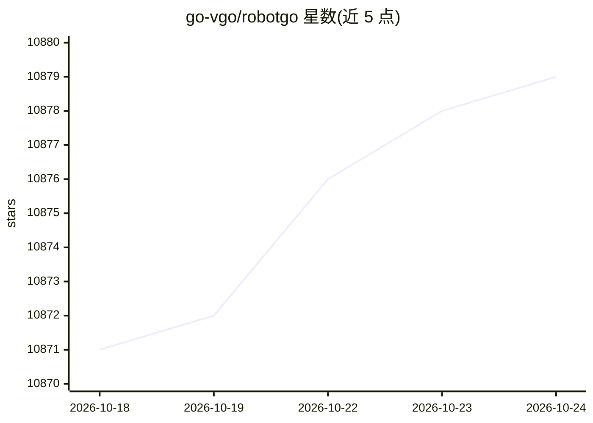

# go-vgo/robotgo

⭐ 10,881 · Go · Apache-2.0 · 推送 2026-10-22 · [GitHub](https://github.com/go-vgo/robotgo) · [官网](https://atomai.cc) · 个人维护 · 中文 README

**Go 跨平台桌面自动化库：控制键鼠、读屏、窗口与进程**

Go 语言的原生跨平台 GUI 自动化/RPA 库，提供鼠标键盘控制、屏幕与位图读取、窗口管理、进程与句柄操作、全局事件监听（GoHook）及 OpenCV 示例，支持 macOS/Windows/Linux 的 arm64 与 x86-amd64。默认后端基于 Cgo 需 C 编译器与平台库，另有实验性纯 Go 后端（build tag 选择 win/mac/x11/wayland/libei）。README 标注可用于 AI Computer Use 场景，并提及闭源的 RobotGo-Pro 多语言版本。

## 筛选速览

| 维度 | 判定 | 备注 |
|---|---|---|
| AI 角色 | `ai-enhanced` | 去掉 AI 部分产品仍成立 |
| 许可风险 | `permissive` | Apache-2.0 |
| 部署形态 | `None` |  |
| 模型依赖 | — | README 未给出锁定关系 |
| 硬件要求 | — | 无带数字的原话,不猜 |
| 安装摩擦 | `medium` | 含编译或系统依赖之一 |
| 成熟度 | `idea` | |

## 能力要点

- 鼠标、键盘、屏幕捕获、位图、窗口与进程控制的跨平台 API
- 默认 Cgo 后端与实验性纯 Go 后端（CGO_ENABLED=0 + build tag）双路径
- 支持 Wayland（wlroots 协议）与 libei（GNOME/KDE RemoteDesktop portal）
- ADB 绑定：打包 android adb 与 ios wda 的兼容 API

## 适用场景

- 编写跨平台 GUI 自动化与自动化测试脚本
- 为 AI computer-use 类 agent 提供键鼠与屏幕控制能力
- 构建 RPA 流程或全局事件监听工具

## 场景标签

`GUI 自动化` · 领域:效率与自动化

## 证据(README 行号)

> L15: > Golang Desktop Automation, auto test and AI Computer Use.
> L16: > Control the mouse, keyboard, read the screen, process, Window Handle, image and bitmap and global event listener.
> L20: I build Codg now, Easy code and work AI agent system: auto, asynchronous, concurrency, efficiently and High accurac

## 星数曲线

2026-10-18 10,871 → 2026-10-24 10,879（+8）

---
*卡片 v1 · prompt 1.4 · 生成 2026-10-20 · 置信度 mid · 依据 README sha `b93ec927e500` · [字段定义](../../DATASET.md)*
