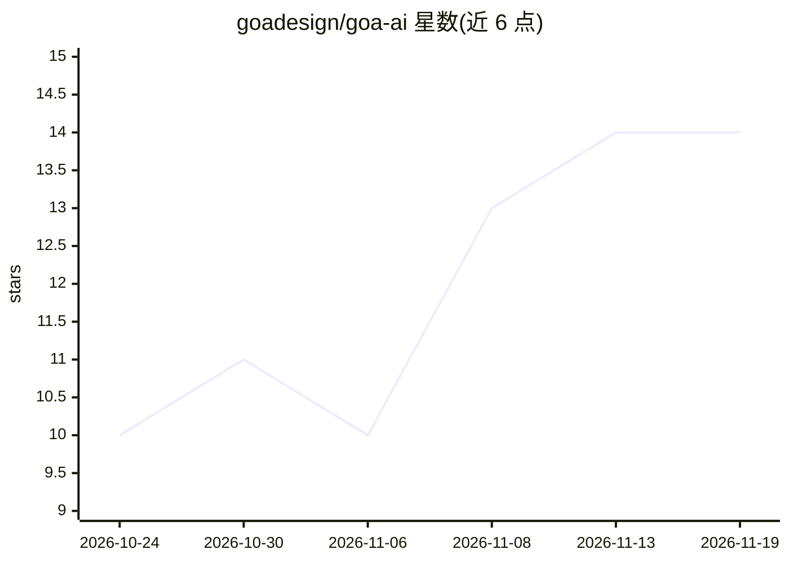

# goadesign/goa-ai

⭐ 14 · Go · MIT · 推送 2026-11-11 · [GitHub](https://github.com/goadesign/goa-ai) · [官网](https://goa.design/docs/2-goa-ai/) · 组织维护

**Go 语言设计优先的 AI agent/MCP 框架：声明式生成类型化运行时**

Goa DSL 的 AI 扩展：在 Go 设计文件中声明 agent、工具、MCP 客户端/服务器、分布式工具注册表与结构化模型输出，通过 goa gen 命令生成类型化接口、JSON Schema、验证、编解码与运行时接线，业务逻辑仍用普通 Go 实现。同一设计可同时产出 HTTP、gRPC、MCP 工具与本地 agent 工具。支持可组合提示词、人工审批的持久化继续、分页工具调用、OAuth/签名令牌授权与 Temporal/Redis/MongoDB 持久执行（quickstart 无需这些依赖）。面向 Go 工程师与 coding agent，要求 Go 1.27.0+。

## 筛选速览

| 维度 | 判定 | 备注 |
|---|---|---|
| AI 角色 | `ai-ecosystem` | LLM/agent 周边工具 |
| 许可风险 | `permissive` | MIT |
| 部署形态 | `library` | 以包/库形式分发 |
| 模型依赖 | — | README 未给出锁定关系 |
| 硬件要求 | — | 无带数字的原话,不猜 |
| 安装摩擦 | `low` | 无编译、无系统依赖或容器化 |
| 成熟度 | — | 结构信号不足 |

## 能力要点

- 一份 Go 设计生成类型化 agent 工具、MCP 客户端/服务器及 HTTP/gRPC API
- 生成时校验的可组合提示词（missingkey=error、字段引用检查、OpenTelemetry 追踪）
- 无效工具调用的纠正机制与恢复预算
- MCP 2026-07-28 over HTTP/stdio，含资源、提示词、进度订阅、OAuth 授权与 Apps/Skills

## 适用场景

- 用设计优先方式为 Go 服务生成 AI agent 与类型化工具
- 将现有 Go 方法暴露为 MCP 工具或 MCP 服务器
- 跨服务发布与发现工具注册表，路由到带租约的 provider
- 需要人工审批、分页与持久化执行的 agent 工作流

## 场景标签

`Agent 框架` `代码生成` · 领域:Agent 开发

## 证据(README 行号)

> L21: Goa-AI extends Goa with AI agents, the Model Context Protocol
> L23: clients, servers, model schemas, validation, and runtime wiring. Implement your
> L42: |**An MCP server** exposing Go service methods, resources, and prompts, or **an MCP client** consuming them|MCP int

## 星数曲线

2026-10-24 10 → 2026-11-19 14（+4）

---
*卡片 v1 · prompt 1.4 · 生成 2026-11-18 · 置信度 mid · 依据 README sha `8f7fdc0e010f` · [字段定义](../../DATASET.md)*
