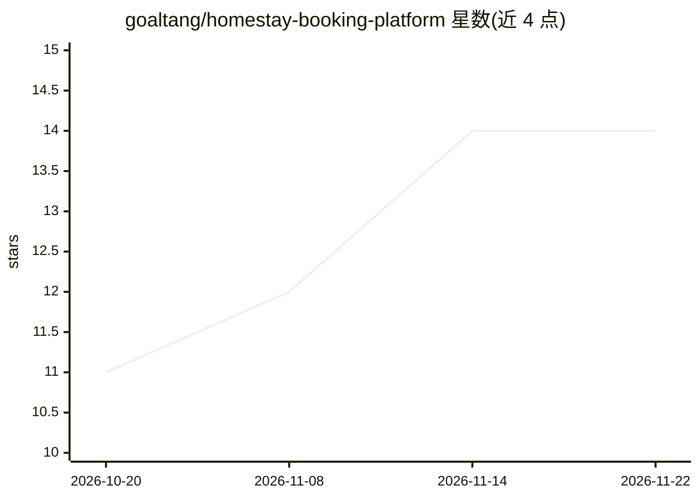

# goaltang/homestay-booking-platform

⭐ 14 · Java · 推送 2026-11-16 · [GitHub](https://github.com/goaltang/homestay-booking-platform) · 个人维护 · 中文 README

**面向房客、房东与管理员的全栈民宿预订系统**

覆盖房源发布与审核、搜索推荐、下单支付、入住退房、退款争议与收益管理的预订系统，含 25 个业务模块。后端 Spring Boot 3 + MySQL/Redis/Elasticsearch/RabbitMQ，前端 Vue 3 双应用；通过死信队列实现订单超时关闭、批量发券与消息推送，AOP 实现限流与审计日志。含带权限边界的 AI 客服 Agent（工具白名单、用户确认后提交）。作者声明为学习与面试展示用途的单人项目，明确不作为生产部署保障；支持 Docker 一键演示与本地源码开发两种运行方式。

## 筛选速览

| 维度 | 判定 | 备注 |
|---|---|---|
| AI 角色 | `ai-enhanced` | 去掉 AI 部分产品仍成立 |
| 许可风险 | `none` | — |
| 部署形态 | `self-host` | docker 或自建部署 |
| 模型依赖 | — | README 未给出锁定关系 |
| 硬件要求 | — | 无带数字的原话,不猜 |
| 安装摩擦 | `low` | 无编译、无系统依赖或容器化 |
| 成熟度 | `idea` | |

## 能力要点

- 支付宝沙箱支付流程：异步回调、状态查询、超时处理与退款
- RabbitMQ TTL+DLX 死信队列驱动订单超时、批量发券、通知推送
- AI 客服 Agent 按工具白名单编排，写操作先起草再经用户确认
- Elasticsearch 检索与基于订单/收藏/浏览行为的推荐画像

## 适用场景

- 学习 Spring Boot 全栈项目的订单、支付与消息队列实践
- 搭建民宿类预订业务的演示环境
- 参考带权限边界与用户确认机制的客服 Agent 设计

## 场景标签

`聊天机器人` · 领域:对话与助手

## 证据(README 行号)

> L11: 面向房客、房东和平台管理员的民宿预订系统，覆盖房源发布与审核、搜索推荐、下单支付、入住退房、退款争议和收益管理。
> L39: - **有权限边界的 AI 客服 Agent**：只读咨询通过工具白名单编排；退款申请、取消订单和争议申请先起草，再经用户确认提交，并校验订单归属。管理员裁决建议仅生成草稿。

## 星数曲线

2026-10-20 11 → 2026-11-22 14（+3）

---
*卡片 v1 · prompt 1.4 · 生成 2026-11-18 · 置信度 high · 依据 README sha `9aa281c15c27` · [字段定义](../../DATASET.md)*
