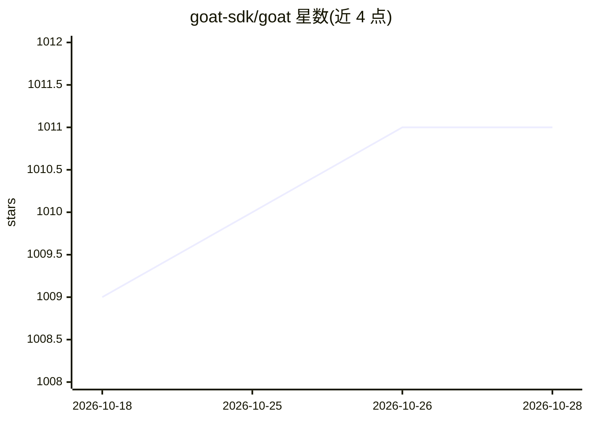

# goat-sdk/goat

⭐ 1,014 · TypeScript · MIT · 推送 2026-07-02 · [GitHub](https://github.com/goat-sdk/goat) · 组织维护

**面向 AI agent 的链上金融工具包：200+ 区块链支付/交易/投资工具**

GOAT 是一个 TypeScript 与 Python 工具包，用于让 AI agent 具备链上金融能力：收发支付、购买商品与加密资产、赚取收益、参与预测市场、资产代币化等。机制上以区块链、稳定币与钱包为基础设施，提供 200+ 插件（0x、Jupiter、Uniswap、Polymarket 等）、多链钱包适配（EVM/Solana/Starknet 等），以及到 LangChain、Vercel AI、CrewAI、MCP 等 agent 框架的适配器。核心精简、按需安装插件。仓库已归档，不再接受 issue 与更新，以现状提供。

## 筛选速览

| 维度 | 判定 | 备注 |
|---|---|---|
| AI 角色 | `ai-ecosystem` | LLM/agent 周边工具 |
| 许可风险 | `permissive` | MIT |
| 部署形态 | `library` | 以包/库形式分发 |
| 模型依赖 | — | README 未给出锁定关系 |
| 硬件要求 | — | 无带数字的原话,不猜 |
| 安装摩擦 | `low` | 无编译、无系统依赖或容器化 |
| 成熟度 | — | 结构信号不足 |

## 能力要点

- 200+ 金融/链上工具插件，按需安装
- 多链钱包适配（EVM、Solana、Starknet、Sui 等十余种）
- 10+ agent 框架适配器（LangChain、CrewAI、MCP、Vercel AI 等）
- TypeScript 与 Python 双语言包

## 适用场景

- 让 AI agent 持有钱包并自主执行链上支付与交易
- 为 agent 框架接入 DeFi、NFT 购买、预测市场等金融工具
- 在多个 EVM 兼容链与 Solana 上构建可交易的 agent

## 场景标签

`金融量化` · 领域:学习与行业

## 证据(README 行号)

> L22: GOAT is the **largest agentic finance toolkit** for AI agents.
> L41: 3. Use more than **+200 tools**
> L42: 4. Use it with **any agent framework** of your choice

## 星数曲线

2026-10-18 1,009 → 2026-10-28 1,011（+2）

---
*卡片 v1 · prompt 1.4 · 生成 2026-10-21 · 置信度 high · 依据 README sha `b1820f91fde2` · [字段定义](../../DATASET.md)*
