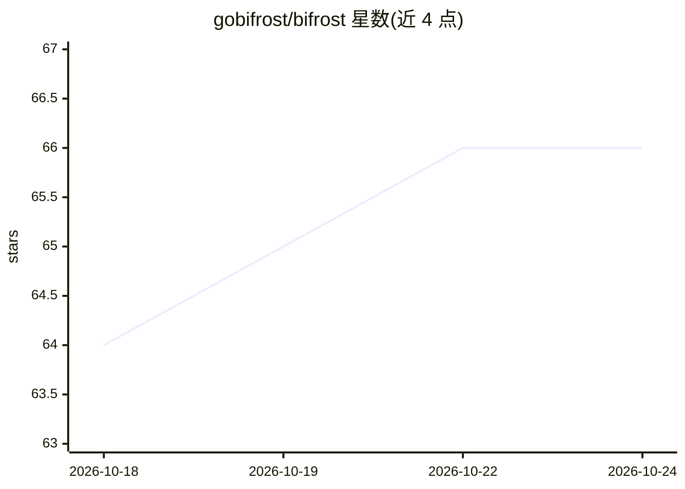

# gobifrost/bifrost

⭐ 66 · Python · AGPL-3.0 · 推送 2026-10-23 · [GitHub](https://github.com/gobifrost/bifrost) · [官网](https://gobifrost.com) · 个人维护

**面向 MSP 集成服务的开源自托管自动化平台**

面向集成服务（Integration Services）行业的多租户自动化平台，以 Python 编写工作流，同时保留 RPA 式管理抽象：OAuth 令牌自动刷新、Fernet 加密的密钥管理、动态表单、按组织隔离的多租户架构。技术栈为 React + FastAPI + PostgreSQL + Redis，通过 Docker Compose 部署，含调度器与 worker 执行工作流。定位为可自托管、避免厂商锁定的 RPA 替代路径；README 提及可用 Claude Code 等 AI 编码工具辅助开发工作流，并有 Zero Trust 运行权限检查与 Sigstore 签名的发布产物。

## 筛选速览

| 维度 | 判定 | 备注 |
|---|---|---|
| AI 角色 | `ai-enhanced` | 去掉 AI 部分产品仍成立 |
| 许可风险 | `viral` | AGPL-3.0 |
| 部署形态 | `self-host` | docker 或自建部署 |
| 模型依赖 | — | README 未给出锁定关系 |
| 硬件要求 | — | 无带数字的原话,不猜 |
| 安装摩擦 | `low` | 无编译、无系统依赖或容器化 |
| 成熟度 | — | 结构信号不足 |

## 能力要点

- 多租户架构，按组织做数据隔离，模块可跨客户复用
- OAuth 自动刷新、加密密钥管理、动态表单与工作流
- Docker Compose 一键部署，工作流/表单热重载
- Zero Trust Automation 按运行者角色与组织范围校验每次运行

## 适用场景

- 集成服务/MSP 团队为客户构建可复用的 API 自动化集成
- 以 Python 代码而非 RPA 专有语法编写并版本管理自动化流程
- 自托管平台集中管理多客户的 OAuth 连接与密钥

## 场景标签

`工作流自动化` · 领域:效率与自动化

## 证据(README 行号)

> L20: Built by someone with nearly 20 years of MSP experience and a deep passion for scaling solutions for the industry a
> L82: - **AI-Assisted Development** - Built for modern AI coding workflows

## 星数曲线

2026-10-18 64 → 2026-10-24 66（+2）

---
*卡片 v1 · prompt 1.4 · 生成 2026-10-24 · 置信度 mid · 依据 README sha `1bd86fd61f1b` · [字段定义](../../DATASET.md)*
