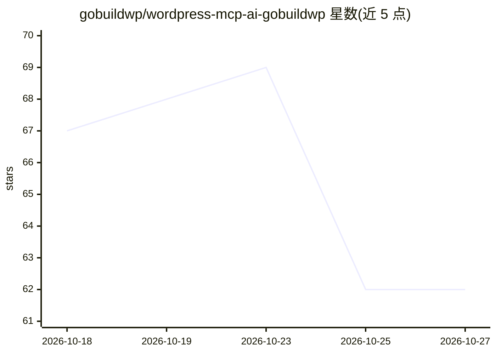

# gobuildwp/wordpress-mcp-ai-gobuildwp

⭐ 62 · PHP · GPL-2.0 · 推送 2026-10-25 · [GitHub](https://github.com/gobuildwp/wordpress-mcp-ai-gobuildwp) · [官网](https://gobuildwp.com) · 组织维护

**把 WordPress 站点变成 MCP 服务器，供 AI 客户端建站改站**

自托管的 WordPress MCP 服务器插件，基于 WordPress Abilities API 与官方 MCP Adapter：Claude、ChatGPT、Cursor、Codex 等 MCP 客户端的 agent 通过三工具接口调用 233 个类型化能力，构建和编辑文章、Gutenberg 区块、Elementor 元素树、菜单、媒体与 SEO 元数据，执行 PageSpeed、WCAG 2.2 与安全检查，读取 WooCommerce 与七种 SEO 插件数据。写入受用户权限、安全配置与可撤销变更台账约束。不内置模型，策略在本站执行；免费版无需许可，Pro 增加 WooCommerce 写入、其他页面构建器、安全更新与备份，另有托管多站的 GoBuildWP Cloud。

## 筛选速览

| 维度 | 判定 | 备注 |
|---|---|---|
| AI 角色 | `ai-ecosystem` | LLM/agent 周边工具 |
| 许可风险 | `viral` | GPL-2.0 |
| 部署形态 | `desktop` | 安装包/桌面程序 |
| 模型依赖 | locked-api |  |
| 硬件要求 | — | 无带数字的原话,不猜 |
| 安装摩擦 | `medium` | 含编译或系统依赖之一 |
| 成熟度 | — | 结构信号不足 |

## 能力要点

- 233 个类型化 WordPress 能力，经三工具 MCP 接口暴露
- 免费版即含 Elementor MCP：读取与增删改移动元素树、一次调用构建整页
- 每次写入记入可撤销变更台账，可按单条/批次/整个 agent 会话回滚
- PageSpeed（无需 Google key）、WCAG 2.2、内容与配置安全检查

## 适用场景

- 让 Claude/Cursor 等 agent 用自然语言编辑我的 Elementor 页面
- AI 建整站：规划、批量构建草稿、人工审批后发布
- 对站点做无障碍、链接与安全审计并让 agent 修复

## 场景标签

`网络安全` · 领域:学习与行业

## 证据(README 行号)

> L14: **GoBuildWP turns your WordPress site into an MCP server.** Connect Claude, ChatGPT, Claude Code, Codex, Cursor or 
> L31: GoBuildWP is a self-hosted **WordPress MCP server** built on the WordPress Abilities API and the official WordPress
> L33: It is a control layer, not an AI wrapper. **No AI model is bundled**: your MCP client brings its own model access, 

## 星数曲线

2026-10-18 67 → 2026-10-27 62（-5）

---
*卡片 v1 · prompt 1.4 · 生成 2026-10-24 · 置信度 high · 依据 README sha `9756e102e26c` · [字段定义](../../DATASET.md)*
