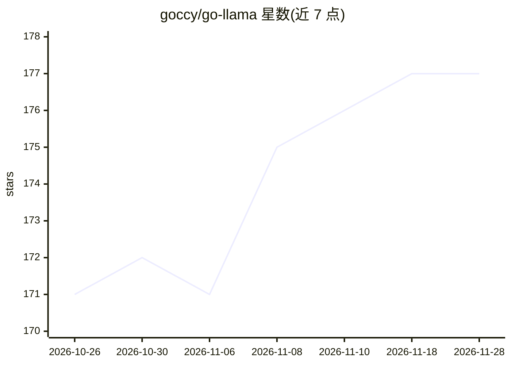

# goccy/go-llama

⭐ 177 · Go · MIT · 推送 2026-10-22 · [GitHub](https://github.com/goccy/go-llama) · 个人维护

**让 Go 开发者在无 cgo 下运行 GGUF 模型的推理库**

将 llama.cpp 编译为 WebAssembly 后翻译为 Go 代码的推理引擎库，运行时不依赖 wasm 运行时与共享库，产出单一静态二进制，支持 CGO_ENABLED=0。提供独立实例、单模型多上下文 KV 缓存共享、连续批处理 slots、流式输出、可中断生成、投机解码、LoRA、GBNF 语法采样、嵌入与状态存取。限制：wasm32 线性内存上限 4 GiB，建议使用约 3B 参数 Q4 量化以下模型。

## 筛选速览

| 维度 | 判定 | 备注 |
|---|---|---|
| AI 角色 | `ai-ecosystem` | LLM/agent 周边工具 |
| 许可风险 | `permissive` | MIT |
| 部署形态 | `None` |  |
| 模型依赖 | local-ok | 支持本地模型 |
| 硬件要求 | — | 无带数字的原话,不猜 |
| 安装摩擦 | `low` | 无编译、无系统依赖或容器化 |
| 成熟度 | — | 结构信号不足 |

## 能力要点

- 纯 Go 实现，无 cgo、无共享库，单一静态二进制
- 多实例隔离与单模型多上下文 KV 缓存共享
- slots 连续批处理（示例 32 slots、p50 1.5 s / 655 tok/s）
- 流式生成与跨 goroutine 中断

## 适用场景

- 在 Go 服务中以无 cgo 方式嵌入 GGUF 模型推理
- 一个模型同时服务多个独立会话
- 用单实例跑主模型+草稿模型做投机解码

## 场景标签

`推理引擎` · 领域:训练与推理

## 证据(README 行号)

> L6: **llama.cpp in pure Go — run GGUF models anywhere Go runs. No cgo, no shared
> L10: llama.cpp compiled to WebAssembly and
> L24: - **Pure Go**: works anywhere Go compiles; `CGO_ENABLED=0` friendly.

## 星数曲线

2026-10-26 171 → 2026-11-28 177（+6）

---
*卡片 v1 · prompt 1.4 · 生成 2026-11-26 · 置信度 high · 依据 README sha `18a3fce0e0d2` · [字段定义](../../DATASET.md)*
