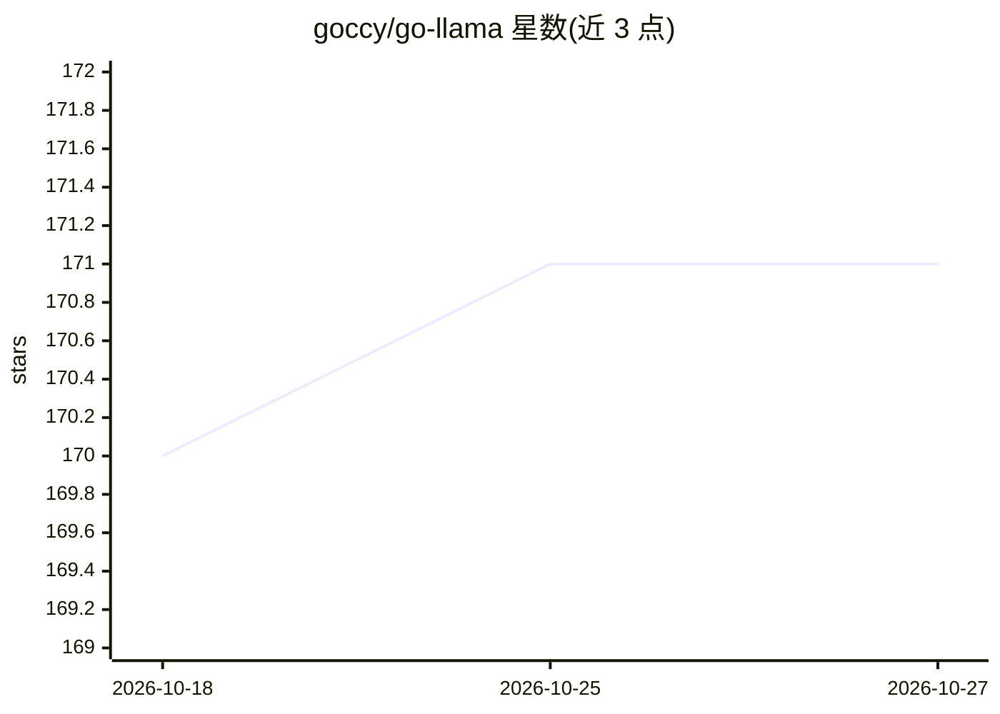

# goccy/go-llama

⭐ 171 · Go · MIT · 推送 2026-10-22 · [GitHub](https://github.com/goccy/go-llama) · 个人维护

**纯 Go 实现的 llama.cpp 推理引擎，运行 GGUF 模型**

将 llama.cpp 编译为 WebAssembly 再转译为 Go 的推理引擎库，运行时不依赖 wasm 运行时、无 cgo、无共享库，产出单一静态二进制。面向 Go 开发者，以 Go API 提供 GGUF 模型加载、生成、流式输出、多实例隔离、多上下文共享权重、slots 连续批处理、采样与 GBNF 语法、投机解码、LoRA、嵌入、状态存取及可配置沙箱。限制：wasm32 线性内存上限 4 GiB，适配 Q4 量化约 3B 参数以内的模型。

## 筛选速览

| 维度 | 判定 | 备注 |
|---|---|---|
| AI 角色 | `ai-ecosystem` | LLM/agent 周边工具 |
| 许可风险 | `permissive` | MIT |
| 部署形态 | `None` |  |
| 模型依赖 | local-ok | 支持本地模型 |
| 硬件要求 | — | 无带数字的原话,不猜 |
| 安装摩擦 | `low` | 无编译、无系统依赖或容器化 |
| 成熟度 | — | 结构信号不足 |

## 能力要点

- 纯 Go、CGO_ENABLED=0 友好，单一静态二进制
- 多实例隔离与单实例多模型多上下文（共享权重、独立 KV cache）
- slots 连续批处理：单上下文并发多请求
- 投机解码、LoRA adapters、GBNF 语法、状态保存/加载

## 适用场景

- 在任意 Go 编译目标上离线运行 GGUF 量化模型
- 用单实例多上下文服务多个独立对话
- 通过沙箱选项限制模型引擎的内存与文件系统访问

## 场景标签

`推理引擎` · 领域:训练与推理

## 证据(README 行号)

> L6: **llama.cpp in pure Go — run GGUF models anywhere Go runs. No cgo, no shared
> L9: The inference engine is
> L10: llama.cpp compiled to WebAssembly and

## 星数曲线

2026-10-18 170 → 2026-10-27 171（+1）

---
*卡片 v1 · prompt 1.4 · 生成 2026-10-22 · 置信度 high · 依据 README sha `f640eae4e427` · [字段定义](../../DATASET.md)*
