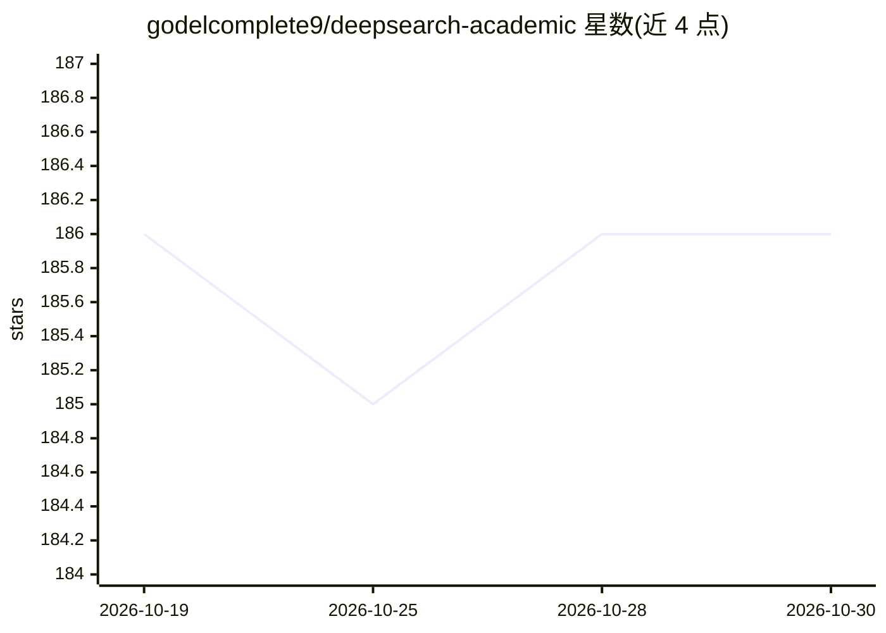

# godelcomplete9/deepsearch-academic

⭐ 186 · Python · 推送 2026-08-14 · [GitHub](https://github.com/godelcomplete9/deepsearch-academic) · 个人维护

**本地学术文献检索问答助手：搜论文、RAPTOR 索引、回答问题**

面向学生与研究者的本地研究助手：给定主题后调用 Semantic Scholar 搜索论文，经出版方过滤与 LLM 相关性检查，构建 RAPTOR 摘要树并用 FAISS 检索，回答仅基于检索到的节点，可导出学术式 PDF 报告、Mermaid 流程图与文献清单。算法封装在 Python 包 academic_deepsearch 中，Streamlit 仅作 UI；全部对话、摘要与嵌入通过 llama.cpp llama-server 的 OpenAI 兼容 /v1 API 完成，需分别运行聊天与嵌入两个服务器进程。提供 Docker compose 与离线测试套件。

## 筛选速览

| 维度 | 判定 | 备注 |
|---|---|---|
| AI 角色 | `ai-native` | 本体是模型或模型工具 |
| 许可风险 | `none` | — |
| 部署形态 | `self-host` | docker 或自建部署 |
| 模型依赖 | local-ok | 支持本地模型 |
| 硬件要求 | — | 无带数字的原话,不猜 |
| 安装摩擦 | `low` | 无编译、无系统依赖或容器化 |
| 成熟度 | — | 结构信号不足 |

## 能力要点

- Semantic Scholar 检索 + 出版方/LLM 双重过滤
- RAPTOR 聚类摘要树 + FAISS 检索的对话式 QA
- 学术式 PDF 报告与 Mermaid 流程图导出
- 核心为不含 Streamlit 依赖的 Python 包，可独立调用

## 适用场景

- 文献综述起点：按主题自动搜集并筛选论文
- 基于真实摘要的本地可检查 RAG 问答
- 快速摸清某方法的核心原始论文

## 场景标签

`RAG` `科研工具` · 领域:知识与检索

## 证据(README 行号)

> L3: A local research assistant: you give it a topic, it searches Semantic Scholar, filters papers, builds a RAPTOR summa
> L12: 4. **Conversational QA** — answers are grounded in retrieved nodes only.

## 星数曲线

2026-10-19 186 → 2026-10-30 186（+0）

---
*卡片 v1 · prompt 1.4 · 生成 2026-10-22 · 置信度 mid · 依据 README sha `649315799070` · [字段定义](../../DATASET.md)*
