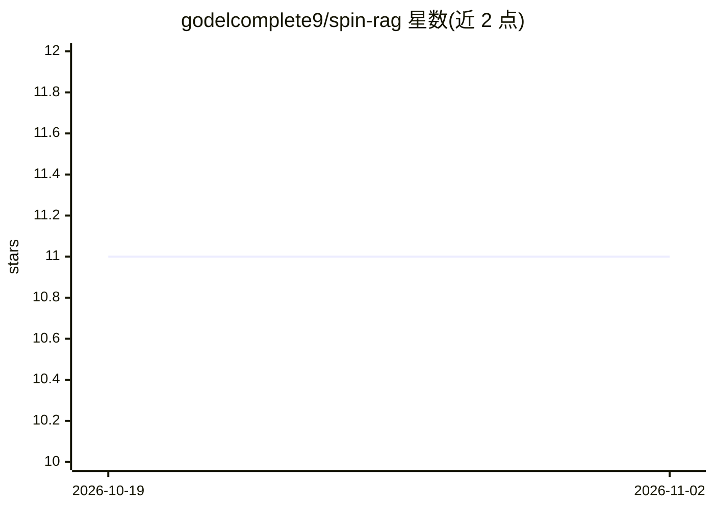

# godelcomplete9/spin-rag

⭐ 11 · Python · 推送 2026-08-14 · [GitHub](https://github.com/godelcomplete9/spin-rag) · [官网](https://ai.studio/apps/278d6780-100d-48d3-8b0b-72e206adf6fd?fullscreenApplet=true) · 个人维护

**把损坏业务记录修复为自演化知识图谱的 RAG 库**

面向损坏业务记录（残缺账目行、OCR 导出、截断条目）的 Python RAG 库：将每行文本分类为四种类型（TOP/BOTTOM/LEFT/RIGHT），在多个演化 epoch 中让残缺片段与最近完整条目经 LLM 融合，生成新的完整条目并保留溯源边。查询时按类型选择规则，TOP 查询返回原文零幻觉，其他类型经护栏生成。后端支持 OpenRouter 与自托管 llama.cpp 服务器，提供 Dash 演示、离线测试套件与 Docker 部署。

## 筛选速览

| 维度 | 判定 | 备注 |
|---|---|---|
| AI 角色 | `ai-ecosystem` | LLM/agent 周边工具 |
| 许可风险 | `none` | — |
| 部署形态 | `self-host` | docker 或自建部署 |
| 模型依赖 | local-ok | 支持本地模型 |
| 硬件要求 | — | 无带数字的原话,不猜 |
| 安装摩擦 | `low` | 无编译、无系统依赖或容器化 |
| 成熟度 | — | 结构信号不足 |

## 能力要点

- 四类型粒子分类驱动的生产规则与多 epoch 图自修复
- 每条生成文档携带 epoch_history 与溯源边，可审计
- 按查询类型选择幻觉契约：TOP 查询纯抽取返回原文
- 本地运行无需 API key：llama.cpp + 自有 GGUF 权重

## 适用场景

- 对含截断行和残缺条目的账目/工单导出做 RAG 检索
- 需要可审计溯源的检索问答
- 全本地部署的知识图谱 RAG 场景

## 场景标签

`RAG` `知识图谱` · 领域:知识与检索

## 证据(README 行号)

> L5: > A typed, self-evolving knowledge graph for RAG over **damaged business records** — fiscal ledgers, OCR dumps, half
> L27: |Index step|one-shot embed|one-shot extract entities|**iterative LLM-mediated fusion across epochs**|
> L205: **`SpinRAG(content, n_epochs=5, llm_model=..., embed_model=..., backend=BACKEND_OPENROUTER, base_url=None, api_key

## 星数曲线

2026-10-19 11 → 2026-11-02 11（+0）

---
*卡片 v1 · prompt 1.4 · 生成 2026-11-02 · 置信度 high · 依据 README sha `561989455b28` · [字段定义](../../DATASET.md)*
