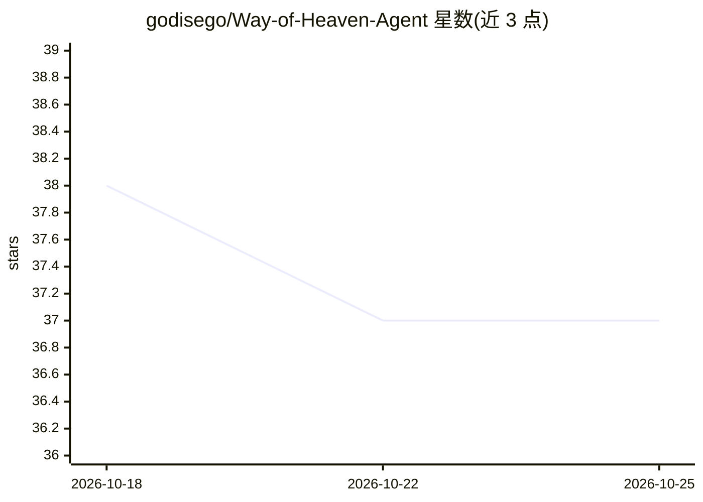

# godisego/Way-of-Heaven-Agent

⭐ 37 · TypeScript · MIT · 推送 2026-09-29 · [GitHub](https://github.com/godisego/Way-of-Heaven-Agent) · [官网](https://tiandaoagent.bbroot.com) · 个人维护 · 中文 README

**学习 AI Agent 的零框架实践场：手写 RAG 与工具循环，兼学八字命理**

以「三贤茶寮」对谈为载体的个人学习项目：零框架手写最小 Agent 工具循环（search_library/read_source_unit/ready_to_answer，zod 校验、证据台账、执行轨迹面板）、分库 RAG、引用逐条校验与定向重试、声口校验、联网搜索回退；配套学习中心 11 节引导课与 55 篇讲义、132 词条命理速查、77 道自测题。命理部分为确定性规则引擎排盘（真太阳时、起运精确到日）。Next.js 15 全栈，本地优先，不配 API Key 可用大半功能。声明 BM25 混合检索、OCR、多用户部署未开始。

## 筛选速览

| 维度 | 判定 | 备注 |
|---|---|---|
| AI 角色 | `ai-native` | 本体是模型或模型工具 |
| 许可风险 | `permissive` | MIT |
| 部署形态 | `None` |  |
| 模型依赖 | — | README 未给出锁定关系 |
| 硬件要求 | — | 无带数字的原话,不猜 |
| 安装摩擦 | `low` | 无编译、无系统依赖或容器化 |
| 成熟度 | — | 结构信号不足 |

## 能力要点

- 零框架手写 Agent 工具循环，执行轨迹面板可视化，可切回固定 RAG 对照
- 引用逐条比对检索证据，造假引用整组作废并定向重试
- 132 词条命理规则引擎，排盘与释义由确定性代码推算，模型零参与
- 55 篇讲义 + 77 道自测题 + 132 项命理交叉速查的学习馆

## 适用场景

- 零框架亲手跑通并观察 RAG 与 Agent 工具循环的每个机制
- 上传自己的典籍，获得带页码级引用核对的三角色对谈回答
- 通过可点击排盘与词条速查学习八字命理体系

## 场景标签

`RAG` `教程课程` · 领域:知识与检索

## 证据(README 行号)

> L18: 这个项目为两件事而生，**重心是学 AI Agent**：把 RAG、引用校验、最小工具循环这些机制零框架亲手写一遍，再配一座「学习中心」把每个机制讲成课；其次是**学命理**——把八字排盘做成可点击的活教材，每个干支、十神、大运
> L20: 你带着一个困惑落座，三位常驻「贤者」默认按固定次序回应你——也可以直接点头像请其中一两位下席，让最合适的角色单独深答。不聊模板话，不做救世主，回答必须援引你**亲自上传**的典籍，且每条引用可以点开核对到 PDF 页码或章节原文；
> L28: 三条铁律贯穿全部实现：**本地优先**（数据不出本机）、**确定性优先**（排盘与命理解释由代码推算，模型只解读）、**学习优先**（RAG 与 Agent 机制全部手写，项目本身即教材）。

## 星数曲线

2026-10-18 38 → 2026-10-25 37（-1）

---
*卡片 v1 · prompt 1.4 · 生成 2026-10-25 · 置信度 high · 依据 README sha `b76bdfeed5dd` · [字段定义](../../DATASET.md)*
